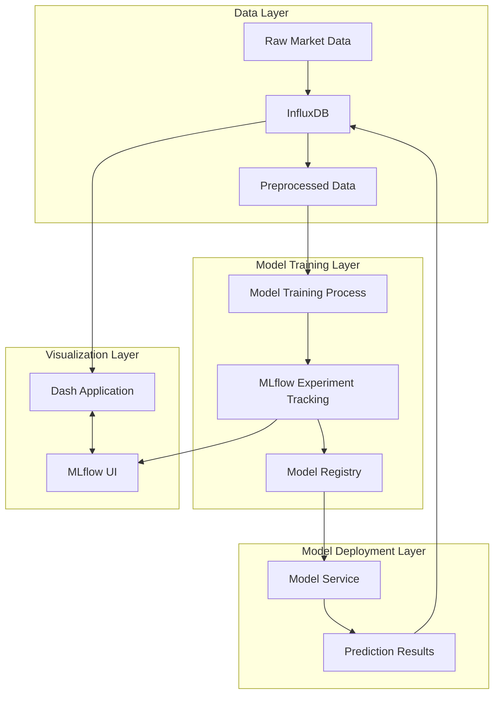

# Enhanced Data Storage and Visualization Plan

## Executive Summary

This document outlines a comprehensive plan for implementing an enhanced data storage and visualization solution for our stock analysis system. The solution will replace the current file-based storage with InfluxDB, a time-series database optimized for handling large volumes of time-series data efficiently. For visualization, we'll implement a Plotly Dash application that provides interactive dashboards with real-time updates and advanced charting capabilities. The solution will also integrate with our existing MLflow experiment tracking system.

## Current State Assessment

Our current implementation has:

1. **Storage Abstraction Layer**:
   - A `StorageManager` class that provides a unified interface for different storage backends
   - Three backends: CSV, SQLite, and a placeholder for a time-series database
   - Data is primarily stored in local files, which limits scalability and query performance

2. **Visualization**:
   - A Streamlit dashboard for stock analysis and trading signals
   - Integration with MLflow for tracking experiments
   - Basic charts for signal distribution and performance metrics

## Requirements

1. **Data Storage**:
   - Handle large volumes of time-series data efficiently (thousands of stocks with minute-level data)
   - Provide fast query performance for both historical analysis and real-time dashboards
   - Support model parameter storage and version control

2. **Visualization**:
   - Interactive dashboards with customizable views
   - Real-time updates
   - Various chart types (candlestick, line, volume) with technical indicators
   - Ability to compare multiple stocks simultaneously

3. **MLflow Integration**:
   - Leverage existing MLflow experiment tracking
   - Provide unified model lifecycle management
   - Enable model version comparison and rollback

## Proposed Solution: InfluxDB + Plotly Dash

### 1. Data Storage: InfluxDB

InfluxDB is ideal for our needs because:
- It's purpose-built for time-series data
- It offers excellent query performance for both recent and historical data
- It supports SQL-like queries with Flux query language
- It's open-source with a strong community
- It scales well for large datasets (thousands of stocks with minute-level data)

### 2. Visualization: Plotly Dash

Plotly Dash is a perfect match for our visualization needs:
- It provides interactive, web-based dashboards
- It supports real-time updates
- It offers various chart types including candlestick charts for financial data
- It allows comparison of multiple data series (stocks) simultaneously
- It integrates well with our Python codebase

### 3. MLflow Integration

We'll integrate our existing MLflow experiment tracking with the new storage and visualization solution:
- MLflow will continue to handle experiment tracking and model artifacts
- InfluxDB will store time-series data and production model parameters
- Dash will provide a unified interface for both systems

## Architecture Diagram



## Implementation Plan

### Phase 1: InfluxDB Implementation

#### 1.1 Setup InfluxDB

1. Install InfluxDB (Docker container recommended for development):
   ```bash
   docker run -d -p 8086:8086 \
     -e DOCKER_INFLUXDB_INIT_MODE=setup \
     -e DOCKER_INFLUXDB_INIT_USERNAME=admin \
     -e DOCKER_INFLUXDB_INIT_PASSWORD=marketsageadmin \
     -e DOCKER_INFLUXDB_INIT_ORG=marketsage \
     -e DOCKER_INFLUXDB_INIT_BUCKET=stock_data \
     -e DOCKER_INFLUXDB_INIT_ADMIN_TOKEN=marketsagetoken \
     --name influxdb influxdb:2.0
   ```

2. Configure database settings:
   - Organization: `marketsage`
   - Bucket: `stock_data`
   - Retention policy: `forever` (no expiration for historical data)

#### 1.2 Implement InfluxDB Storage Backend

Create a new file `modules/storage_backends/influxdb_storage.py` that implements the `StorageBackend` interface with InfluxDB-specific functionality:

- Methods for saving and loading time-series data
- Methods for storing and retrieving model parameters
- Support for model versioning and rollback
- Integration with MLflow experiment tracking

#### 1.3 Update StorageManager

Update the `StorageManager` class to support the new InfluxDB backend:

```python
def _create_backend(self, backend_type: str, **kwargs) -> StorageBackend:
    """Create a storage backend based on the specified type."""
    if backend_type == "csv":
        from modules.storage_backends.csv_storage import CSVStorage
        return CSVStorage(**kwargs)
    elif backend_type == "sqlite":
        from modules.storage_backends.sqlite_storage import SQLiteStorage
        return SQLiteStorage(**kwargs)
    elif backend_type == "tsdb":
        from modules.storage_backends.tsdb_storage import TimeSeriesDBStorage
        return TimeSeriesDBStorage(**kwargs)
    elif backend_type == "influxdb":  # Add new backend type
        from modules.storage_backends.influxdb_storage import InfluxDBStorage
        return InfluxDBStorage(**kwargs)
    else:
        raise ValueError(f"Unknown backend type: {backend_type}")
```

### Phase 2: Plotly Dash Implementation

#### 2.1 Create Dash Application Structure

Create a new file `dash_app.py` that implements the Dash application:

- Interactive stock charts with technical indicators
- Model version management interface
- MLflow integration for experiment tracking

#### 2.2 Create CSS for Dash App

Create a new directory `assets` and add a file `style.css` for styling the Dash application.

#### 2.3 Implement Model Version Management

Add model version management functionality to the Dash application:

- Version listing with filtering and sorting
- Version details view
- Version comparison
- Rollback functionality

#### 2.4 Implement MLflow Integration

Add MLflow integration to the Dash application:

- Experiment listing
- Run details view
- Model registration
- Links between InfluxDB versions and MLflow runs

### Phase 3: Data Migration

#### 3.1 Create Migration Script

Create a file `migrate_to_influxdb.py` that migrates data from existing storage to InfluxDB:

- Migrate stock data from CSV/SQLite to InfluxDB
- Migrate model parameters from CSV/SQLite to InfluxDB
- Link existing MLflow experiments to InfluxDB versions

### Phase 4: Docker Setup

#### 4.1 Create Docker Compose Configuration

Create a file `docker-compose.yml` for easy deployment:

```yaml
version: '3'

services:
  influxdb:
    image: influxdb:2.0
    container_name: marketsage-influxdb
    ports:
      - "8086:8086"
    volumes:
      - influxdb-data:/var/lib/influxdb2
    environment:
      - DOCKER_INFLUXDB_INIT_MODE=setup
      - DOCKER_INFLUXDB_INIT_USERNAME=admin
      - DOCKER_INFLUXDB_INIT_PASSWORD=marketsageadmin
      - DOCKER_INFLUXDB_INIT_ORG=marketsage
      - DOCKER_INFLUXDB_INIT_BUCKET=stock_data
      - DOCKER_INFLUXDB_INIT_ADMIN_TOKEN=marketsagetoken
    restart: unless-stopped

  dash:
    build:
      context: .
      dockerfile: Dockerfile.dash
    container_name: marketsage-dash
    ports:
      - "8050:8050"
    environment:
      - INFLUXDB_URL=http://influxdb:8086
      - INFLUXDB_TOKEN=marketsagetoken
      - INFLUXDB_ORG=marketsage
      - INFLUXDB_BUCKET=stock_data
    depends_on:
      - influxdb
    restart: unless-stopped

volumes:
  influxdb-data:
```

#### 4.2 Create Dockerfile for Dash App

Create a file `Dockerfile.dash`:

```dockerfile
FROM python:3.9-slim

WORKDIR /app

# Install dependencies
COPY requirements.txt .
RUN pip install --no-cache-dir -r requirements.txt

# Copy application code
COPY . .

# Expose port
EXPOSE 8050

# Run the application
CMD ["python", "dash_app.py"]
```

#### 4.3 Update Requirements

Update `requirements.txt` to include the new dependencies:

```
# Existing dependencies
pandas
numpy
yfinance
matplotlib
scikit-learn
mlflow
streamlit

# New dependencies
influxdb-client
dash
plotly
gunicorn
```

## Implementation Steps

1. **Install Dependencies**:
   ```bash
   pip install influxdb-client dash plotly
   ```

2. **Implement the InfluxDB Storage Backend**:
   - Create the `modules/storage_backends/influxdb_storage.py` file
   - Update the `StorageManager` class to support the new backend

3. **Create the Dash Application**:
   - Create the `dash_app.py` file
   - Create the `assets/style.css` file

4. **Create the Data Migration Script**:
   - Create the `migrate_to_influxdb.py` file

5. **Setup Docker Environment** (optional):
   - Create the `docker-compose.yml` file
   - Create the `Dockerfile.dash` file
   - Update `requirements.txt`

6. **Run InfluxDB**:
   ```bash
   # Using Docker
   docker run -d -p 8086:8086 \
     -e DOCKER_INFLUXDB_INIT_MODE=setup \
     -e DOCKER_INFLUXDB_INIT_USERNAME=admin \
     -e DOCKER_INFLUXDB_INIT_PASSWORD=marketsageadmin \
     -e DOCKER_INFLUXDB_INIT_ORG=marketsage \
     -e DOCKER_INFLUXDB_INIT_BUCKET=stock_data \
     -e DOCKER_INFLUXDB_INIT_ADMIN_TOKEN=marketsagetoken \
     --name influxdb influxdb:2.0
   ```

7. **Migrate Data**:
   ```bash
   python migrate_to_influxdb.py --source-backend csv --influxdb-token marketsagetoken
   ```

8. **Run Dash Application**:
   ```bash
   INFLUXDB_TOKEN=marketsagetoken python dash_app.py
   ```

## Phased Implementation Approach

To minimize disruption and manage complexity, we'll implement the solution in phases:

### Phase 1: Basic Implementation (1-2 weeks)
- Set up InfluxDB
- Implement basic InfluxDB storage backend
- Create simple Dash application for data visualization
- Migrate historical data

### Phase 2: Enhanced Features (2-3 weeks)
- Implement model version management
- Add technical indicators and advanced charting
- Implement basic MLflow integration
- Enhance Dash UI with filtering and comparison features

### Phase 3: Advanced Features (3-4 weeks)
- Implement full MLflow integration
- Add model comparison and rollback functionality
- Implement data lifecycle management (retention policies, downsampling)
- Add user authentication and access control

## Scalability Considerations

For scaling to thousands of stocks with minute-level data:

1. **Data Partitioning**:
   - Use InfluxDB's automatic time-based partitioning
   - Implement custom retention policies for different time granularities

2. **Query Optimization**:
   - Use InfluxDB's tag indexing for efficient filtering
   - Implement query result caching
   - Pre-compute common aggregations

3. **Frontend Optimization**:
   - Implement data downsampling for visualization
   - Use pagination and virtual scrolling for large datasets
   - Implement asynchronous loading and progressive rendering

4. **Infrastructure Scaling**:
   - For higher loads, consider upgrading to InfluxDB Enterprise or InfluxDB Cloud
   - Deploy Dash application with Gunicorn for multi-process serving
   - Implement load balancing for multiple Dash instances

## Conclusion

The proposed InfluxDB + Plotly Dash solution provides a robust, scalable, and feature-rich platform for stock data storage and visualization. By leveraging InfluxDB's time-series optimization and Dash's interactive visualization capabilities, we can significantly improve the performance and usability of our stock analysis system. The integration with MLflow ensures a seamless workflow from experiment to production, with comprehensive model lifecycle management.