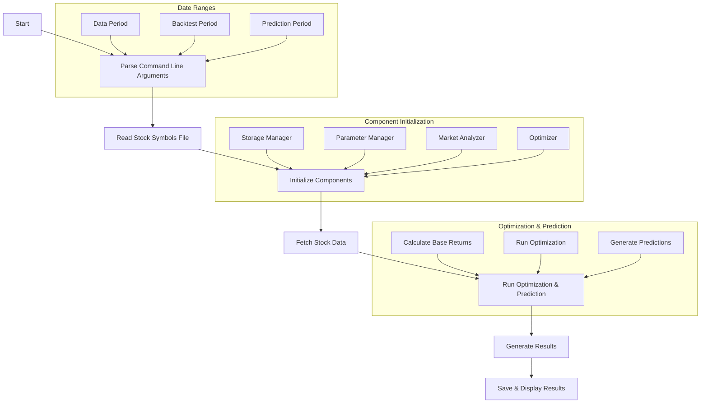

# Stock Prediction Entry Program Rewrite Plan

## Overview
Rewrite the entry program to implement stock prediction based on test_real_stocks.py with configurable parameters and file-based stock symbol input.

## Command Line Interface

```python
Arguments:
  --symbols-file: Path to stock symbols file (required)
  
  # Data Download Period
  --data-start-date: Start date for historical data download (default: 2020-01-01)
  --data-end-date: End date for historical data download (default: current_date)
  
  # Backtest Period
  --backtest-start-date: Start date for backtesting (default: 2023-01-01)
  --backtest-end-date: End date for backtesting (default: current_date)
  
  # Prediction Period
  --prediction-start-date: Start date for predictions (default: current_date)
  --prediction-end-date: End date for predictions (default: current_date + 30 days)
  
  --output-dir: Results output directory (default: data/results)
```

## Architecture



## Implementation Details

### 1. Core Components
- StorageManager: Data persistence and retrieval
- StockParameterManager: Parameter optimization
- MarketAnalyzer: Market condition analysis
- ContinuousOptimizer: Optimization process
- ThreadPoolExecutor: Parallel processing

### 2. Main Process Flow
1. Load and validate stock symbols from input file
2. Initialize all required components
3. Fetch historical data for each stock based on data date range
4. For each stock:
   - Calculate base performance metrics
   - Run optimization process over backtest period
   - Generate predictions for prediction period
   - Calculate improvement metrics
5. Save results to CSV with timestamp
6. Display summary statistics

### 3. Features from test_real_stocks.py
- Momentum-based backtesting with realistic returns
- Direct parameter testing for optimization
- Enhanced metrics tracking and preservation
- Risk controls for volatility and drawdown
- Improved win rate calculations with momentum effects

### 4. Output Format
Generated CSV report will include:
- Stock symbol
- Market condition
- Base metrics (returns, Sharpe ratio, volatility)
- Optimized metrics (accuracy, win rate)
- Improvement percentages
- Predictions for specified horizon

### 5. Performance Metrics
Monitor and report:
- Sharpe ratios
- Win rates
- Returns
- Max drawdown
- Volatility
- Prediction accuracy

### 6. Error Handling
- Validate all input dates
- Handle missing data gracefully
- Provide clear error messages for:
  * Invalid date ranges
  * Missing stock data
  * Failed optimizations
  * Prediction errors

## Implementation Steps
1. Update argument parsing for date ranges
2. Integrate stock symbol file reading
3. Implement date range validation
4. Modify data fetching for date ranges
5. Update optimization process
6. Enhance prediction generation
7. Update results formatting and saving
8. Add comprehensive logging
9. Implement error handling