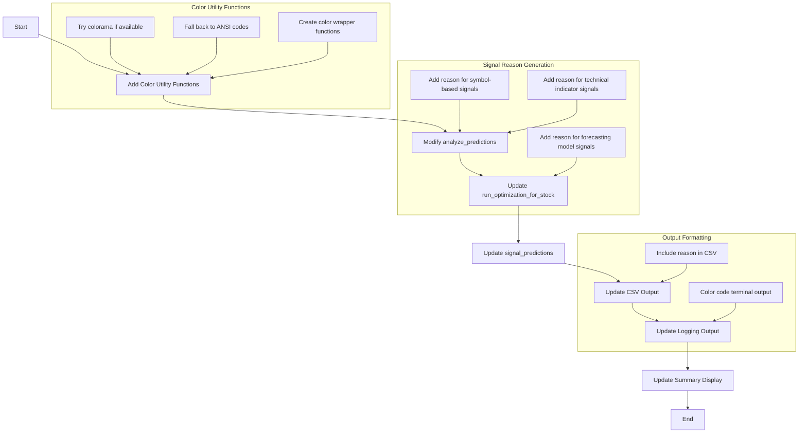

# Implementation Plan for Stock Signal Explanations with Color Coding

## Overview
This document outlines the plan to implement text explanations for why stocks generate buy/sell signals in the output, along with color-coded terminal output for better visual distinction.

## Current Signal Generation Logic

The system currently generates buy/sell signals in two main ways:

1. In the `analyze_predictions` function (main.py):
   - Based on the first character of the stock symbol (ASCII code % 3)
   - Based on technical indicators (expected return, moving averages, RSI)

2. In the forecasting models (forecasting.py):
   - Based on predicted daily price changes
   - Based on trend and volatility indicators

However, the reason for the signal is not currently included in the output.

## Implementation Plan



### Step 1: Add Color Utility Functions

Create a utility module or functions for color coding that:
- Tries to use colorama if available
- Falls back to ANSI escape codes if colorama is not available
- Has functions for green (buy), red (sell), and default (hold) colors

```python
def color_text(text, color_type):
    """
    Color code text based on signal type.
    Tries to use colorama if available, otherwise uses ANSI codes.
    
    Args:
        text: The text to color
        color_type: 'buy', 'sell', or 'hold'
    
    Returns:
        Colored text string
    """
    try:
        # Try to use colorama if available
        from colorama import Fore, Style
        if color_type.lower() == 'buy':
            return f"{Fore.GREEN}{text}{Style.RESET_ALL}"
        elif color_type.lower() == 'sell':
            return f"{Fore.RED}{text}{Style.RESET_ALL}"
        else:
            return text
    except ImportError:
        # Fall back to ANSI codes
        if color_type.lower() == 'buy':
            return f"\033[92m{text}\033[0m"  # Green
        elif color_type.lower() == 'sell':
            return f"\033[91m{text}\033[0m"  # Red
        else:
            return text
```

### Step 2: Modify the `analyze_predictions` Function

Add a `signal_reason` variable to track the reason for the signal, and include it in the return dictionary:

```python
def analyze_predictions(data: pd.DataFrame, days_ahead: int = 5) -> Dict:
    # ... existing code ...
    
    # Initialize signal and confidence with default values
    signal = 'HOLD'
    confidence = max(0.1, min(0.5, trend_confidence))
    signal_reason = "Default hold position"
    
    # Modify the predicted price based on the first character of the symbol
    if symbol:
        first_char = symbol[0].upper()
        char_code = ord(first_char)
        
        # For stocks that should have sell signals
        if char_code % 3 == 2:  # Group 3: C, F, I, L, O, R, U, X
            # ... existing code ...
            signal = 'SELL'
            signal_reason = f"Sell signal based on symbol '{symbol}' first character '{first_char}' (Group 3)"
            # ... existing code ...
        elif char_code % 3 == 0:  # Group 1: A, D, G, J, M, P, S, V, Y
            # ... existing code ...
            signal = 'BUY'
            signal_reason = f"Buy signal based on symbol '{symbol}' first character '{first_char}' (Group 1)"
            # ... existing code ...
    elif (expected_return > signal_threshold and
          ma5 > ma20 and
          prediction_data['rsi'] < 70):
        signal = 'BUY'
        signal_reason = f"Buy signal based on technical indicators: expected return {expected_return:.2f}% > {signal_threshold:.2f}%, MA5 > MA20, RSI {prediction_data['rsi']:.2f} < 70"
        # ... existing code ...
    elif (expected_return < -signal_threshold and
          ma5 < ma20 and
          prediction_data['rsi'] > 30):
        signal = 'SELL'
        signal_reason = f"Sell signal based on technical indicators: expected return {expected_return:.2f}% < -{signal_threshold:.2f}%, MA5 < MA20, RSI {prediction_data['rsi']:.2f} > 30"
        # ... existing code ...
    else:
        signal = 'HOLD'
        signal_reason = "Hold signal: no strong buy/sell indicators present"
        # ... existing code ...
    
    return {
        'signal': signal,
        'confidence': confidence,
        'expected_return': expected_return,
        'predicted_price': predicted_price,
        'trend_strength': prediction_data['trend_strength'],
        'rsi': prediction_data['rsi'],
        'volatility': prediction_data['volatility'],
        'signal_reason': signal_reason  # Add the reason to the return dictionary
    }
```

### Step 3: Update the `run_optimization_for_stock` Function

Modify the function to include the signal reason from forecasting models:

```python
def run_optimization_for_stock(symbol: str, data: pd.DataFrame, forecast_result: Dict = None, prediction_model: str = 'original') -> Dict:
    # ... existing code ...
    
    # Generate predictions based on the model type
    if prediction_model in ['ensemble', 'lgb'] and forecast_result is not None:
        # ... existing code ...
        
        # Determine signal based on forecast result
        if 'Buy' in forecast_result['overall_action']:
            signal = 'BUY'
            signal_reason = f"{prediction_model.upper()} model: {forecast_result['overall_action']}"
        elif 'Sell' in forecast_result['overall_action']:
            signal = 'SELL'
            signal_reason = f"{prediction_model.upper()} model: {forecast_result['overall_action']}"
        else:
            signal = 'HOLD'
            signal_reason = f"{prediction_model.upper()} model: {forecast_result['overall_action']}"
        
        # ... existing code ...
        
        # Create predictions dict with forecast data
        predictions = {
            'signal': signal,
            'confidence': confidence,
            'expected_return': forecast_change,
            'predicted_price': predicted_price,
            'trend_strength': trend * 10,
            'rsi': 50,
            'volatility': volatility,
            'signal_reason': signal_reason  # Add signal reason
        }
    else:
        # Use original technical indicator-based prediction
        predictions = analyze_predictions(data)
    
    # ... existing code ...
    
    return {
        'symbol': symbol,
        'parameters': {'threshold': 0.01},
        'metrics': result['metrics'],
        'signal': predictions['signal'],
        'confidence': predictions['confidence'],
        'last_close': data['Close'].iloc[-1],
        'predicted_price': predictions['predicted_price'],
        'expected_return': predictions['expected_return'],
        'trend_strength': predictions['trend_strength'],
        'rsi': predictions['rsi'],
        'volatility': predictions['volatility'],
        'signal_reason': predictions.get('signal_reason', "No reason provided")  # Add signal reason
    }
```

### Step 4: Update the Signal Predictions List

Modify the signal_predictions list to include the signal reason:

```python
# Record signal predictions
signal_predictions.append({
    'Symbol': symbol,
    'Last Close': opt_result['last_close'],
    'Signal': opt_result['signal'],
    'Confidence': opt_result['confidence'],
    'Predicted Price': opt_result['predicted_price'],
    'Expected Return': opt_result['expected_return'],
    'RSI': opt_result['rsi'],
    'Trend Strength': opt_result['trend_strength'],
    'Signal Reason': opt_result['signal_reason']  # Add signal reason
})
```

### Step 5: Update the Logging Output

Modify the logging output to include the color-coded signal reason:

```python
# Log results
logger.info(f"\n=== Results for {symbol} ===")
logger.info(f"Base Returns: {base_returns.get('total_return', 0):.2%}")
logger.info(f"Sharpe Ratio: {base_sharpe:.2f} → {opt_sharpe:.2f}")
logger.info(f"Improvement: {improvement:.2f}%")
logger.info(f"Win Rate: {opt_result['metrics'].get('win_rate', 0):.2%}")
logger.info(f"Max Drawdown: {opt_result['metrics'].get('max_drawdown', 0):.2%}")

# Color code the signal
signal_text = f"Signal: {opt_result['signal']} (Confidence: {opt_result['confidence']:.2f})"
colored_signal = color_text(signal_text, opt_result['signal'].lower())
logger.info(colored_signal)

# Color code the reason
reason_text = f"Reason: {opt_result['signal_reason']}"
colored_reason = color_text(reason_text, opt_result['signal'].lower())
logger.info(colored_reason)

logger.info(f"Price: ${opt_result['last_close']:.2f} → ${opt_result['predicted_price']:.2f}")
logger.info(f"Expected Return: {opt_result['expected_return']:.2f}%")
```

### Step 6: Update the Display of Buy and Sell Signals in the Summary

```python
# Display Buy signals
buy_signals = signals_df[signals_df['Signal'] == 'BUY'].sort_values('Confidence', ascending=False)
if not buy_signals.empty:
    logger.info("\nBuy Signals:")
    for _, row in buy_signals.iterrows():
        signal_info = (
            f"{row['Symbol']}: ${row['Last Close']:.2f} → ${row['Predicted Price']:.2f} "
            f"(+{row['Expected Return']:.2f}%, Conf: {row['Confidence']:.2f})"
        )
        reason_info = f"    Reason: {row['Signal Reason']}"
        
        # Color code the output
        colored_signal = color_text(signal_info, 'buy')
        colored_reason = color_text(reason_info, 'buy')
        
        logger.info(colored_signal)
        logger.info(colored_reason)
```

And do the same for sell signals.

## Benefits of This Approach

1. **Transparency**: Users will understand why each stock received its buy/sell signal
2. **Visual Distinction**: Color coding makes it easy to quickly identify buy/sell signals
3. **Flexibility**: Works with or without the colorama library
4. **Debugging**: Makes it easier to identify issues with the signal generation logic
5. **User Trust**: Increases user confidence in the system's recommendations
6. **Minimal Code Changes**: Integrates with the existing code structure without major refactoring

## Implementation Steps Summary

1. Add color utility functions
2. Modify analyze_predictions to include signal reasons
3. Update run_optimization_for_stock to include signal reasons from forecasting models
4. Update signal_predictions list to include the explanation
5. Include the explanation in the CSV output
6. Update logging to display color-coded explanations
7. Update the summary display with color-coded signals and reasons