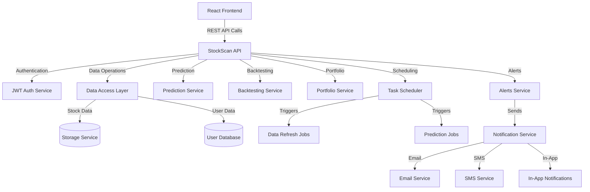
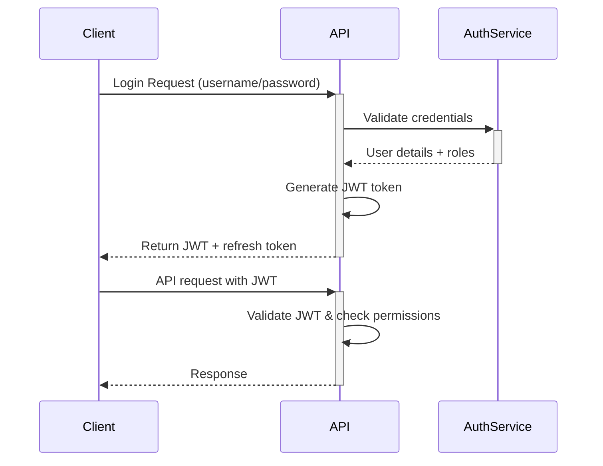
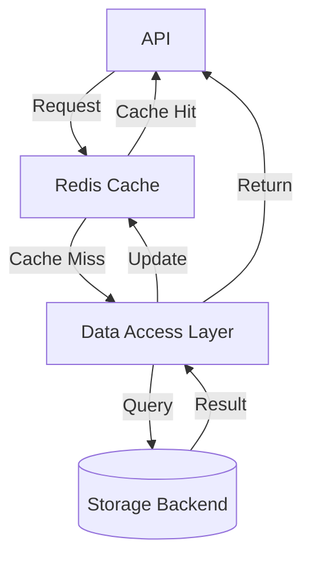
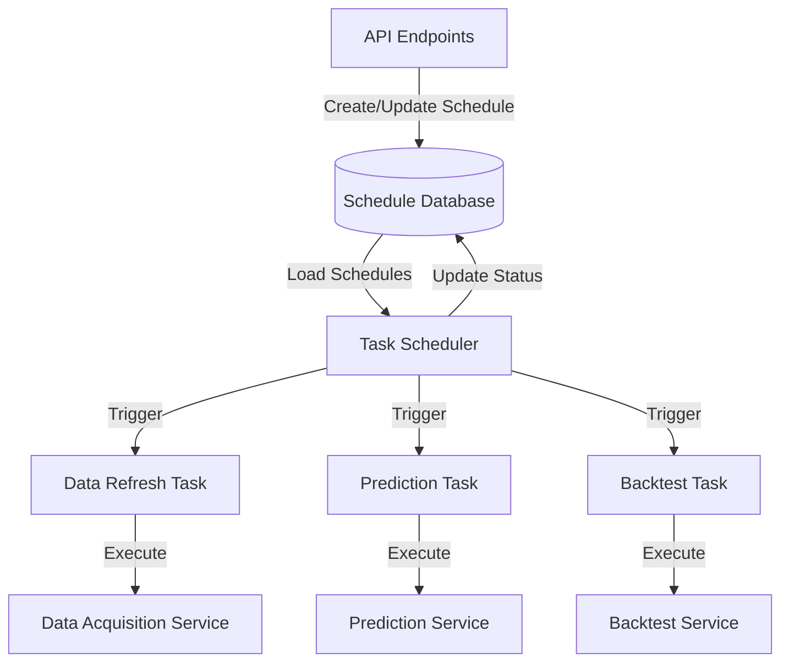
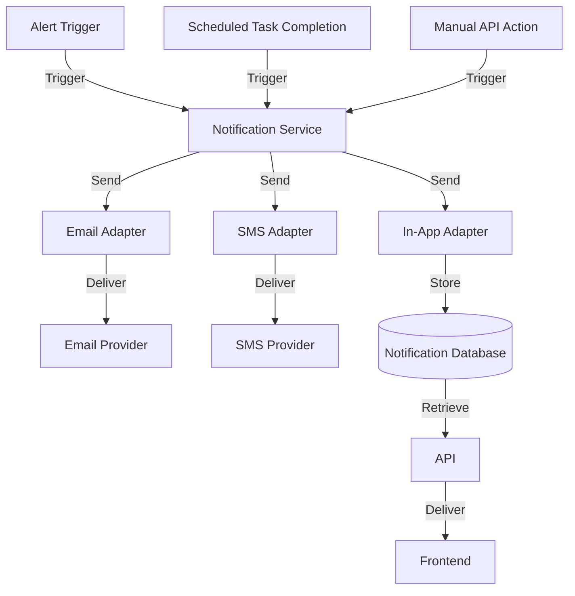
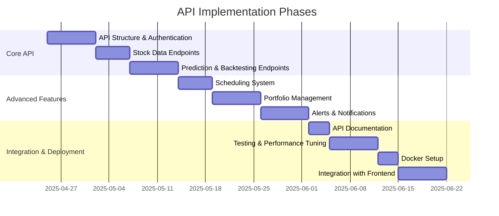
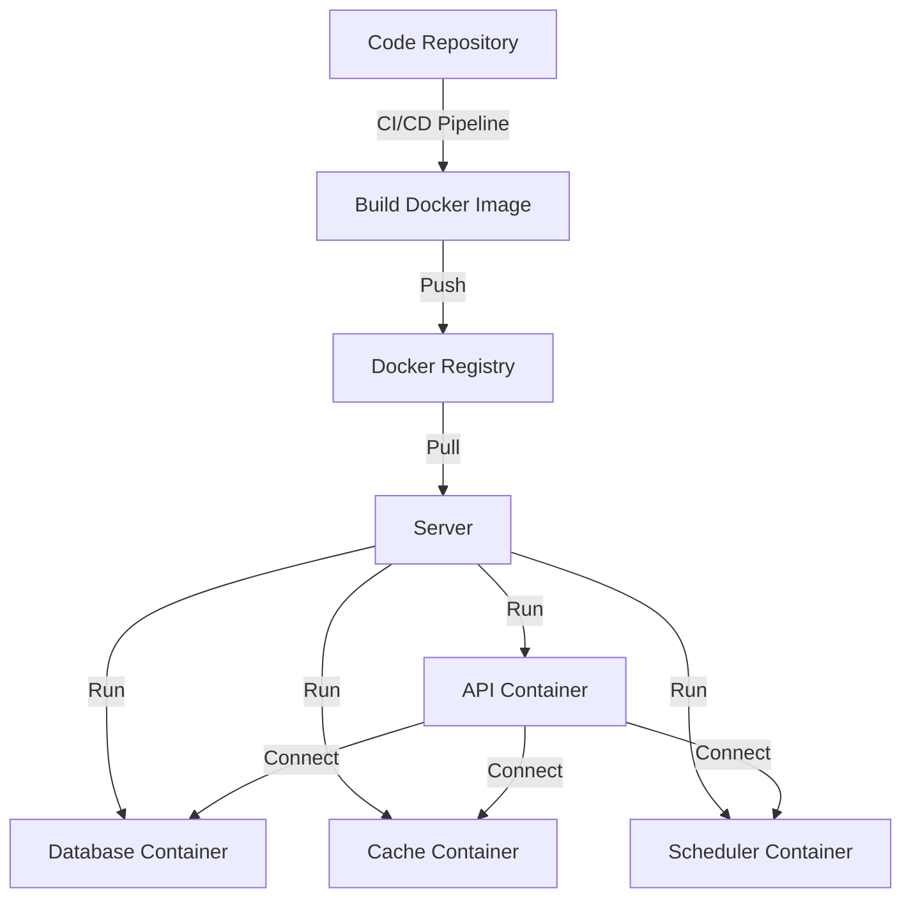

# StockScan API Design Plan

## Table of Contents
1. [Introduction](#introduction)
2. [API Architecture Overview](#api-architecture-overview)
3. [Core Components](#core-components)
   - [Authentication & Authorization](#authentication--authorization)
   - [Data Management](#data-management)
   - [Scheduling System](#scheduling-system)
   - [Notification System](#notification-system)
4. [API Endpoints Structure](#api-endpoints-structure)
5. [Data Models](#data-models)
6. [Implementation Strategy](#implementation-strategy)
7. [Security Considerations](#security-considerations)
8. [Integration with Existing Codebase](#integration-with-existing-codebase)
9. [Deployment Strategy](#deployment-strategy)
10. [Testing Strategy](#testing-strategy)
11. [Documentation](#documentation)

## Introduction

This document outlines the design plan for the StockScan API, which will serve as the backend for a new React-based web portal. The API will provide functionality for stock data management, predictions, backtesting, portfolio management, and alerts/notifications. It will leverage the existing codebase while providing a modern, RESTful interface.

## API Architecture Overview



The architecture follows a service-oriented approach with clear separation of concerns:

- **API Layer**: FastAPI-based REST API endpoints
- **Authentication Layer**: JWT-based authentication and authorization
- **Service Layer**: Business logic for different domains
- **Data Access Layer**: Abstraction over different storage backends
- **Scheduler**: Management of periodic and on-demand tasks
- **Notification System**: Multi-channel notification delivery

## Core Components

### Authentication & Authorization

- **JWT Authentication**: Implement JWT-based authentication with refresh tokens
- **Role-Based Access Control**: Define roles (Admin, Analyst, Regular User)
- **Permission System**: Fine-grained permissions for different API operations



### Data Management

- **Caching Layer**: Implement Redis for caching frequently accessed data
- **Data Retention**: Store historical predictions for 1 year
- **Storage Abstraction**: Continue using the existing storage abstraction layer



### Scheduling System

The scheduling system enables automatic data refreshes, predictions, and backtests based on user-defined schedules.



#### Schedule Definition

Each schedule is defined with:
- Task type (data_refresh, prediction, backtest)
- Timing configuration (cron expression or interval)
- Parameters specific to the task
- Status (active/inactive)

#### Scheduling Mechanisms

- **Cron-like Expressions**: For precise scheduling (e.g., "Every Monday at 9 AM")
- **Interval-based**: For relative scheduling (e.g., "Every 4 hours")
- **One-time**: For scheduled tasks that run once at a specific time

#### Task Types

1. **Data Refresh Tasks**:
   - Parameters: symbols list, date range, data granularity (daily/minutes)
   - Can be configured to fetch only the latest data since last refresh
   - Can target specific symbols or groups of symbols

2. **Prediction Tasks**:
   - Parameters: symbols, model type, prediction periods
   - Can be configured to run after data refresh completes
   - Can use different models for different symbols or time periods

3. **Backtest Tasks**:
   - Parameters: symbols, strategy, parameters, date range
   - Can be scheduled to run periodically to evaluate strategy performance

#### Implementation

- Use APScheduler as the underlying scheduler library
- Run in a separate container but connected to the main API database
- Persist schedule definitions in PostgreSQL for durability
- Track execution history (success/failure, runtime, results summary)
- Implement retry logic for failed tasks

#### API Integration

- Create schedules via API endpoints
- View scheduled tasks and execution history
- Enable/disable schedules
- Manually trigger scheduled tasks immediately
- Get notifications when scheduled tasks complete or fail

#### User Interface Integration

- React frontend would provide a calendar view of scheduled tasks
- Allow drag-and-drop scheduling
- Show execution history and results
- Enable quick creation of common schedules

#### Advanced Features

- **Dependencies**: Allow tasks to depend on other tasks (e.g., run prediction after data refresh)
- **Dynamic Parameters**: Support dynamic parameters based on date or previous results
- **Resource Management**: Limit concurrent tasks to prevent overloading the system
- **Smart Scheduling**: Automatically adjust schedules based on market hours or data availability

### Notification System

The notification system will handle alerts and notifications across multiple channels:



- **Multi-channel Support**: Email, SMS, in-app notifications
- **Template System**: Customizable notification templates
- **Delivery Tracking**: Track notification delivery and read status
- **Batching**: Group notifications to prevent overwhelming users
- **Preferences**: User-configurable notification preferences

## API Endpoints Structure

### Authentication Endpoints

```
POST /api/auth/register - Register new user
POST /api/auth/login - Login user
POST /api/auth/refresh - Refresh JWT token
POST /api/auth/logout - Logout user
GET /api/auth/me - Get current user info
```

### Stock Data Endpoints

```
GET /api/stocks - List available stocks
GET /api/stocks/{symbol} - Get stock details
GET /api/stocks/{symbol}/data - Get stock price data
  - Query params: start_date, end_date, interval (1d, 5m, etc.)
POST /api/stocks/refresh - Manually refresh stock data
  - Body: symbols (array), start_date, end_date
```

### Prediction Endpoints

```
GET /api/predictions - List predictions
GET /api/predictions/{id} - Get prediction details
POST /api/predictions - Create new prediction
  - Body: symbol, model_type, prediction_period, etc.
GET /api/predictions/history - Get prediction history
  - Query params: symbol, start_date, end_date
POST /api/predictions/batch - Create batch predictions
  - Body: symbols (array), model_type, etc.
```

### Backtesting Endpoints

```
POST /api/backtest - Run backtest
  - Body: symbol, strategy, params, start_date, end_date
GET /api/backtest/{id} - Get backtest results
GET /api/backtest/strategies - List available strategies
```

### Scheduling Endpoints

```
GET /api/schedules - List scheduled tasks
POST /api/schedules - Create schedule
  - Body: task_type, cron_expression, params
PUT /api/schedules/{id} - Update schedule
DELETE /api/schedules/{id} - Delete schedule
POST /api/schedules/{id}/execute - Execute schedule immediately
```

### Portfolio Management Endpoints

```
GET /api/portfolios - List user portfolios
POST /api/portfolios - Create portfolio
GET /api/portfolios/{id} - Get portfolio details
PUT /api/portfolios/{id} - Update portfolio
DELETE /api/portfolios/{id} - Delete portfolio
POST /api/portfolios/{id}/positions - Add position to portfolio
PUT /api/portfolios/{id}/positions/{position_id} - Update position
DELETE /api/portfolios/{id}/positions/{position_id} - Remove position
GET /api/portfolios/{id}/performance - Get portfolio performance
POST /api/portfolios/{id}/simulate - Run trading simulation
```

### Alerts Endpoints

```
GET /api/alerts - List user alerts
POST /api/alerts - Create alert
  - Body: type, conditions, notification_channels
GET /api/alerts/{id} - Get alert details
PUT /api/alerts/{id} - Update alert
DELETE /api/alerts/{id} - Delete alert
PUT /api/alerts/{id}/status - Enable/disable alert
GET /api/alerts/history - Get alert history
```

### User Management Endpoints

```
GET /api/users - List users (admin only)
GET /api/users/{id} - Get user details
PUT /api/users/{id} - Update user
DELETE /api/users/{id} - Delete user
PUT /api/users/{id}/roles - Update user roles
```

## Data Models

### User Model

```json
{
  "id": "uuid",
  "username": "string",
  "email": "string",
  "full_name": "string",
  "roles": ["admin", "analyst", "user"],
  "preferences": {
    "default_prediction_period": "30d",
    "notification_preferences": {
      "email": true,
      "sms": false,
      "in_app": true
    }
  },
  "created_at": "timestamp",
  "updated_at": "timestamp"
}
```

### Stock Data Model

```json
{
  "symbol": "string",
  "name": "string",
  "data": [
    {
      "timestamp": "datetime",
      "open": "float",
      "high": "float",
      "low": "float",
      "close": "float",
      "volume": "integer",
      "indicators": {
        "ma_5": "float",
        "ma_20": "float",
        "rsi": "float",
        "macd": "float"
      }
    }
  ],
  "last_updated": "timestamp"
}
```

### Prediction Model

```json
{
  "id": "uuid",
  "symbol": "string",
  "model_type": "string",
  "prediction_period": "string",
  "created_at": "timestamp",
  "user_id": "uuid",
  "status": "string",
  "results": {
    "predicted_prices": ["float"],
    "confidence": "float",
    "signals": ["string"],
    "forecast_change_percent": "float",
    "trend": "float",
    "volatility": "float"
  },
  "metadata": {
    "model_version": "string",
    "features_used": ["string"]
  }
}
```

### Portfolio Model

```json
{
  "id": "uuid",
  "name": "string",
  "user_id": "uuid",
  "description": "string",
  "created_at": "timestamp",
  "updated_at": "timestamp",
  "positions": [
    {
      "id": "uuid",
      "symbol": "string",
      "quantity": "float",
      "entry_price": "float",
      "entry_date": "timestamp",
      "notes": "string"
    }
  ],
  "performance": {
    "total_value": "float",
    "total_return": "float",
    "daily_change": "float"
  },
  "is_simulation": "boolean"
}
```

### Alert Model

```json
{
  "id": "uuid",
  "user_id": "uuid",
  "name": "string",
  "type": "price_target|prediction_signal|technical_indicator",
  "symbol": "string",
  "conditions": {
    "indicator": "string",
    "operator": "above|below|equal",
    "value": "float"
  },
  "notification_channels": ["email", "sms", "in_app"],
  "status": "active|inactive",
  "created_at": "timestamp",
  "updated_at": "timestamp",
  "last_triggered": "timestamp"
}
```

### Schedule Model

```json
{
  "id": "uuid",
  "name": "string",
  "task_type": "data_refresh|prediction|backtest",
  "cron_expression": "string",
  "params": {
    "symbols": ["string"],
    "model_type": "string",
    "prediction_period": "string"
  },
  "user_id": "uuid",
  "status": "active|inactive",
  "last_run": "timestamp",
  "next_run": "timestamp",
  "created_at": "timestamp",
  "updated_at": "timestamp"
}
```

## Implementation Strategy

### Technology Stack

- **API Framework**: FastAPI (high performance, easy to document with OpenAPI)
- **Authentication**: JWT tokens with PyJWT
- **Database**: 
  - PostgreSQL for user data, portfolios, alerts, schedules
  - InfluxDB for time series data (continue using existing implementation)
- **Caching**: Redis
- **Task Scheduling**: APScheduler or Celery
- **Notifications**: Custom service with adapters for email, SMS providers
- **Documentation**: OpenAPI/Swagger via FastAPI's built-in support
- **Containerization**: Docker

### Implementation Phases



### Code Organization

```
/api
  /core
    - config.py
    - security.py
    - dependencies.py
  /routers
    - auth.py
    - stocks.py
    - predictions.py
    - backtest.py
    - schedules.py
    - portfolios.py
    - alerts.py
    - users.py
  /models
    - user.py
    - stock.py
    - prediction.py
    - portfolio.py
    - alert.py
    - schedule.py
  /schemas
    - auth.py
    - stock.py
    - prediction.py
    - portfolio.py
    - alert.py
    - schedule.py
  /services
    - auth_service.py
    - stock_service.py
    - prediction_service.py
    - backtest_service.py
    - portfolio_service.py
    - alert_service.py
    - schedule_service.py
    - notification_service.py
  /db
    - session.py
    - models.py
    - repositories.py
  /utils
    - caching.py
    - scheduling.py
    - notifications.py
  main.py
```

## Security Considerations

- **JWT Security**: Proper token expiration, refresh token rotation
- **Rate Limiting**: Implement rate limiting to prevent abuse
- **Input Validation**: Thorough validation of all API inputs
- **CORS Configuration**: Proper CORS setup for the React frontend
- **Sensitive Data**: Encrypt sensitive user data
- **Logging & Monitoring**: Comprehensive logging for security events
- **Error Handling**: Secure error handling that doesn't leak implementation details

## Integration with Existing Codebase

The new API will leverage the existing modules:
- Use `modules/data_acquisition.py` for stock data fetching
- Use `modules/storage.py` and storage backends for data persistence
- Use `modules/forecasting.py` for prediction functionality
- Use `modules/backtesting.py` for backtesting capabilities

This approach allows us to reuse the existing well-tested functionality while providing a modern API interface.

## Deployment Strategy



- **Docker Compose**: Use Docker Compose for local development
- **Production Deployment**: Docker containers on the company's servers
- **Configuration**: Use environment variables for configuration
- **Monitoring**: Implement health checks and monitoring endpoints
- **Backup Strategy**: Regular database backups

## Testing Strategy

- **Unit Tests**: Test individual components and services
- **Integration Tests**: Test API endpoints with mocked dependencies
- **End-to-End Tests**: Test complete workflows
- **Performance Tests**: Test API performance under load
- **Security Tests**: Test for common security vulnerabilities

## Documentation

- **OpenAPI/Swagger**: Auto-generated API documentation via FastAPI
- **Developer Documentation**: Additional documentation for developers
- **Deployment Documentation**: Instructions for deploying the API
- **User Documentation**: Documentation for API consumers