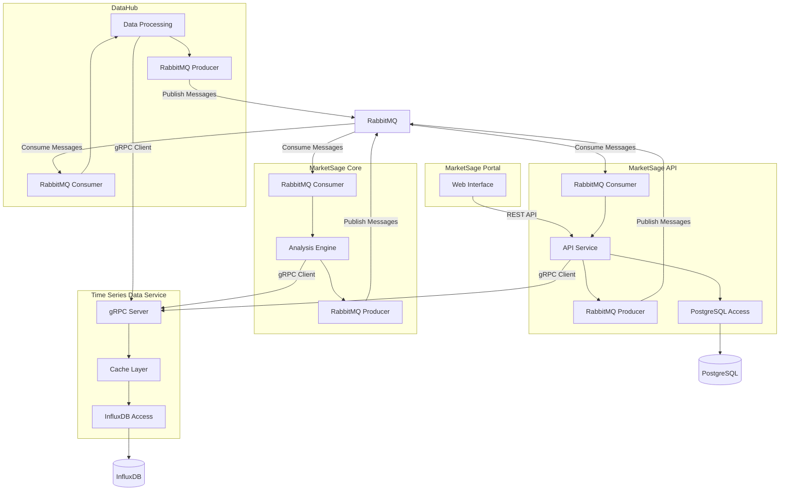
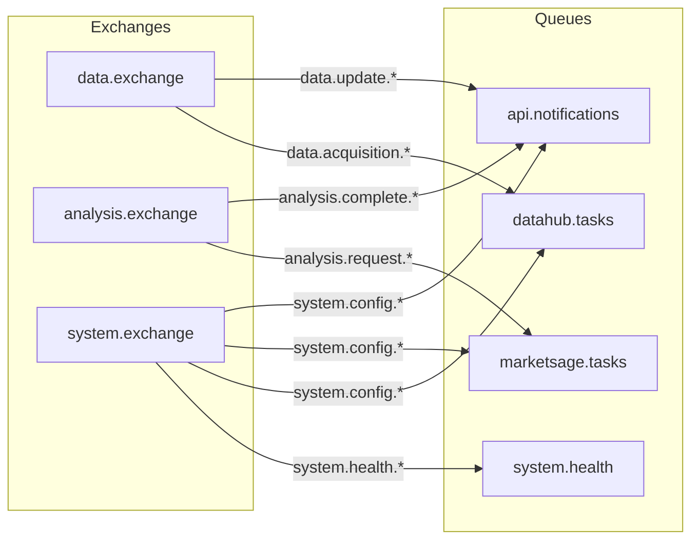

# StockScan Project Splitting Plan

## Overview

This document outlines the plan for splitting the StockScan project into multiple components to address scaling issues with the current monolithic architecture. The primary goals are:

1. Enable independent scaling of components
2. Resolve bottlenecks when running data download concurrently with analysis tasks
3. Improve maintainability through clear separation of concerns
4. Create a more resilient system architecture

## Component Architecture

The StockScan project will be split into five main components:

### 1. MarketSage Core (Analysis Engine)

**Focus**: Stock analysis, prediction, and backtesting functionality

**Key Responsibilities**:
- Stock prediction algorithms
- Backtesting framework
- Market analysis
- Parameter optimization
- Model training and evaluation

**Key Files/Modules**:
- `modules/market_analyzer.py`
- `modules/backtesting.py`
- `modules/parameter_optimizer.py`
- `modules/forecasting.py`
- `modules/trading_prediction/`
- `modules/continuous_optimizer.py`
- `modules/optimized_ensemble/`

### 2. DataHub (Data Management Tool)

**Focus**: Data acquisition, storage, and management

**Key Responsibilities**:
- Stock data downloading
- Symbol management
- Data cleaning and preprocessing
- Time-series data storage

**Key Files/Modules**:
- `modules/data_acquisition.py`
- `modules/stock_manager.py`
- `modules/storage.py`
- `modules/storage_backends/`

### 3. MarketSage API (API Service)

**Focus**: Unified REST API interface

**Key Responsibilities**:
- Authentication and authorization
- Stock data endpoints
- Prediction endpoints
- Scheduling endpoints
- Task management
- Integration with both DataHub and MarketSage Core

**Key Files/Modules**:
- `api/` directory
- `api/routers/`
- `api/schemas/`
- `api/core/`

### 4. Time Series Data Service (TSDS)

**Focus**: Centralized access to time-series data

**Key Responsibilities**:
- Provide consistent API for time-series data operations
- Abstract InfluxDB-specific details
- Implement caching and optimization strategies
- Ensure consistent data access patterns

**Implementation**: gRPC service with Protocol Buffers

### 5. MarketSage Portal (Web Interface)

**Focus**: User interface and visualization

**Key Responsibilities**:
- Data visualization
- Interactive dashboards
- Configuration management
- Results display

**Key Files/Modules**:
- `dash_app.py`
- `assets/`

## Database Strategy

### PostgreSQL (Relational Database)
- **Used By**: MarketSage API
- **Stores**:
  - User management data
  - API data models
  - Configuration storage
  - Task scheduling
  - Authentication data

### InfluxDB (Time-Series Database)
- **Used By**: Time Series Data Service
- **Stores**:
  - Stock price data (OHLCV)
  - Technical indicators
  - Prediction results
  - Backtesting results
  - Performance metrics
  - Model training history

## Communication Architecture

### Component Interaction Diagram



### Message Queue Implementation (RabbitMQ)

RabbitMQ was chosen for the initial implementation due to:

1. **Simpler Setup and Operation**: Easier to deploy and manage with fewer moving parts
2. **Lower Resource Requirements**: Lighter footprint for development and initial production
3. **Mature Client Libraries**: Well-established client libraries for all major languages
4. **Built-in UI**: Management interface for monitoring and administration
5. **Flexible Routing**: Advanced routing capabilities with exchanges and queues
6. **Push Model**: Push-based delivery model that works well for our use cases

#### Exchange and Queue Structure



#### Message Types

1. **Data Acquisition Messages**:
   - `StockDataRequest`: Request to fetch data for specific symbols and date ranges
   - `DataUpdateNotification`: Notification that new data is available
   - `DataErrorAlert`: Notification of errors during data acquisition

2. **Analysis Task Messages**:
   - `AnalysisRequest`: Request to perform specific analysis on given data
   - `ModelTrainingRequest`: Request to train or update a model
   - `OptimizationRequest`: Request to run parameter optimization

3. **Status Update Messages**:
   - `TaskStatusUpdate`: Updates on long-running task progress
   - `AnalysisComplete`: Notification that analysis is complete with results summary
   - `ModelTrainingComplete`: Notification that model training is complete

4. **System Messages**:
   - `ComponentHealthUpdate`: Regular health check messages
   - `ConfigurationChange`: Notification of configuration changes
   - `ResourceUtilization`: Reports on resource usage for monitoring

### Time Series Data Service (gRPC Implementation)

#### Key Features:
1. **High-Performance Protocol**: Binary serialization for efficient data transfer
2. **Strongly Typed Interfaces**: Using Protocol Buffers for clear contract definitions
3. **Streaming Support**: Ideal for time-series data with bidirectional streaming capabilities
4. **Connection Multiplexing**: Better resource utilization with fewer connections

#### Sample Service Definition:
```protobuf
// Simplified example of gRPC service definition
service TimeSeriesDataService {
  // Data storage operations
  rpc StoreStockData(StockDataRequest) returns (StoreResponse);
  rpc StorePredictionResults(PredictionResultsRequest) returns (StoreResponse);
  
  // Data retrieval operations
  rpc GetStockData(StockDataQuery) returns (StockDataResponse);
  rpc GetTechnicalIndicators(IndicatorQuery) returns (IndicatorResponse);
  rpc GetPredictionResults(PredictionQuery) returns (PredictionResponse);
  
  // Streaming operations
  rpc StreamLatestData(SymbolRequest) returns (stream DataPoint);
  
  // Batch operations
  rpc BatchGetStockData(BatchQuery) returns (BatchResponse);
}
```

## Communication Patterns

### Synchronous Operations (via REST API)
- Portal → API: User requests, configuration changes
- DataHub → API: Metadata updates, symbol management
- MarketSage Core → API: Status updates, result summaries

### Asynchronous Operations (via RabbitMQ)
- API → DataHub: Data acquisition requests
- API → MarketSage Core: Analysis requests
- DataHub → MarketSage Core: Data update notifications
- MarketSage Core → API: Analysis completion events

## Directory Structure for New Components

### MarketSage Core
```
marketsage-core/
├── src/
│   ├── market_analyzer/
│   ├── backtesting/
│   ├── forecasting/
│   ├── parameter_optimizer/
│   └── models/
├── tests/
├── config/
├── Dockerfile
├── requirements.txt
└── README.md
```

### DataHub
```
marketsage-datahub/
├── src/
│   ├── acquisition/
│   ├── symbols/
│   ├── storage/
│   └── preprocessing/
├── tests/
├── config/
├── Dockerfile
├── requirements.txt
└── README.md
```

### MarketSage API
```
marketsage-api/
├── src/
│   ├── core/
│   ├── routers/
│   ├── schemas/
│   ├── services/
│   └── utils/
├── tests/
├── alembic/
├── Dockerfile
├── requirements.txt
└── README.md
```

### Time Series Data Service
```
marketsage-tsds/
├── src/
│   ├── server/
│   ├── cache/
│   ├── storage/
│   └── protos/
├── tests/
├── config/
├── Dockerfile
├── requirements.txt
└── README.md
```

### MarketSage Portal
```
marketsage-portal/
├── src/
│   ├── components/
│   ├── layouts/
│   ├── assets/
│   └── services/
├── tests/
├── config/
├── Dockerfile
├── requirements.txt
└── README.md
```

## Implementation Strategy

### Phase 1: Component Separation and Infrastructure Setup
1. Create separate repositories for each component
2. Set up base infrastructure (PostgreSQL, InfluxDB, RabbitMQ)
3. Implement basic gRPC Time Series Data Service
4. Extract core functionality from the monolithic codebase
5. Set up basic CI/CD pipelines

**Key Deliverables**:
- Repository structure for all components
- Infrastructure setup scripts
- Basic functionality in each component
- Initial integration tests

### Phase 2: Core Communication Patterns
1. Implement RabbitMQ producers/consumers in each component
2. Define exchange and queue structures
3. Create gRPC client libraries for components
4. Implement message serialization/deserialization
5. Set up error handling and retry mechanisms

**Key Deliverables**:
- Working message queue communication
- gRPC client libraries
- Integration tests for communication patterns
- Error handling and logging

### Phase 3: API and Portal Development
1. Develop REST API endpoints in MarketSage API
2. Implement Portal interface with API integration
3. Set up authentication and authorization
4. Create user management functionality
5. Implement dashboard and visualization components

**Key Deliverables**:
- Complete REST API
- Working web portal
- Authentication system
- User management features
- Dashboards and visualizations

### Phase 4: Scaling and Optimization
1. Implement caching in Time Series Data Service
2. Monitor RabbitMQ performance and message volumes
3. Optimize database access patterns
4. Implement performance monitoring
5. Set up auto-scaling for components

**Key Deliverables**:
- Caching layer for time-series data
- Performance monitoring dashboards
- Optimized database queries
- Auto-scaling configuration
- Load testing results

## Migration Path Considerations

### Migration from Monolithic to Microservices
1. Start with extracting the most independent components
2. Use feature flags to gradually shift traffic to new components
3. Run old and new systems in parallel during transition
4. Validate data consistency between systems

### Potential Future Migration to Kafka
If message volumes grow beyond RabbitMQ's capacity:
1. Design message schemas to be transport-agnostic from the start
2. Use abstraction layers in producers/consumers
3. Monitor message volumes and performance metrics
4. Prepare Kafka migration plan when specific thresholds are reached

## Benefits of This Architecture

1. **Independent Scaling**:
   - Web portal can scale to handle more users
   - Core analysis can scale for computation-intensive tasks
   - Data acquisition can scale during market hours

2. **Improved Development Workflow**:
   - Teams can work on different components simultaneously
   - Smaller, focused codebases are easier to understand and maintain
   - Component-specific testing is more straightforward

3. **Enhanced Reliability**:
   - Failure in one component doesn't bring down the entire system
   - Components can be updated independently
   - Better isolation of issues and debugging

4. **Optimized Resource Usage**:
   - Resources allocated based on component needs
   - Efficient database usage with specialized access patterns
   - Asynchronous processing reduces bottlenecks

## Conclusion

This project splitting plan provides a clear roadmap for transforming the StockScan monolithic application into a modular, scalable architecture. By following the phased implementation approach, we can gradually migrate functionality while minimizing disruption to existing users and operations.

The architecture addresses the current scaling issues and bottlenecks while providing a foundation for future growth and enhancement. The use of modern technologies like gRPC and RabbitMQ ensures efficient communication between components, while the clear separation of concerns improves maintainability and development velocity.