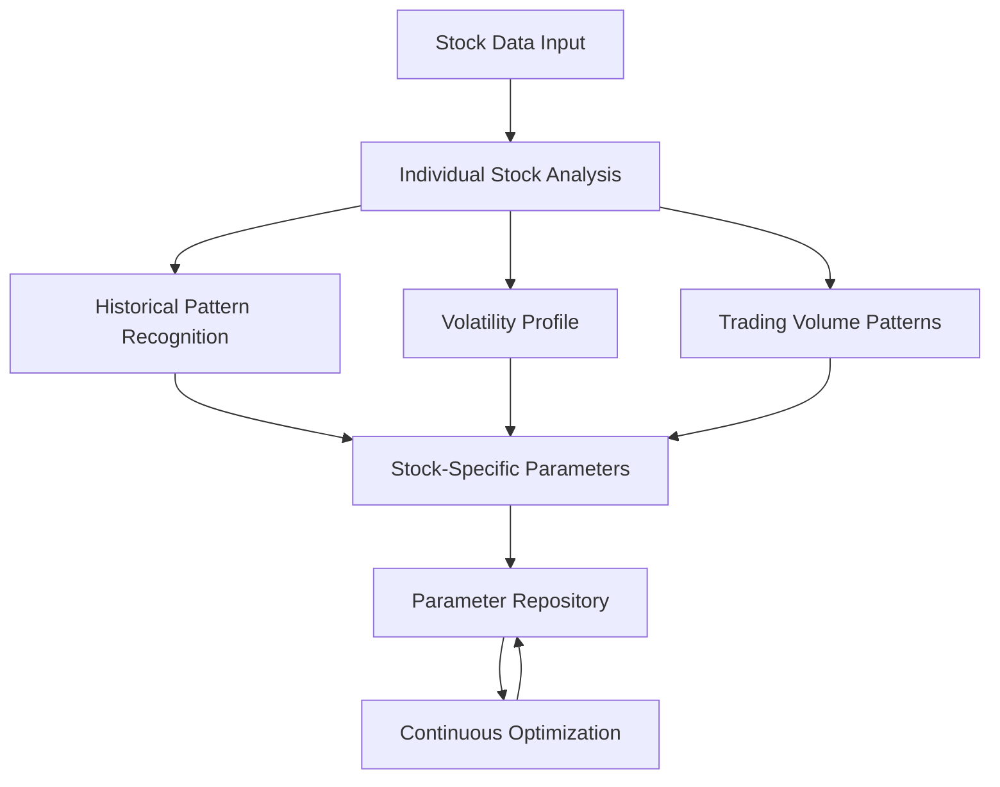
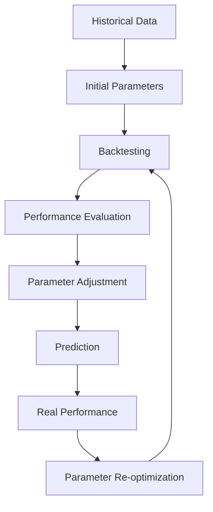

# Adaptive Parameter Optimization System

## 1. Dynamic Parameter Optimization

### Per-Stock Parameter System



### Stock-Specific Parameters

```python
class StockParameterManager:
    def __init__(self):
        self.parameter_store = {}  # Dictionary to store per-stock parameters
        self.optimization_frequency = 5  # trading days
        
    def get_stock_parameters(self, symbol: str) -> Dict:
        """Retrieve stock-specific parameters or create default"""
        if symbol not in self.parameter_store:
            self.parameter_store[symbol] = self._create_default_params()
        return self.parameter_store[symbol]
        
    def _create_default_params(self) -> Dict:
        return {
            'lookback_window': 252,  # Default 1 year
            'volatility_threshold': 0.2,
            'volume_threshold': 1.5,
            'momentum_window': 20,
            'prediction_horizon': 10
        }

    def update_parameters(self, symbol: str, 
                         performance_metrics: Dict,
                         market_conditions: Dict):
        """Update parameters based on performance and conditions"""
        current_params = self.get_stock_parameters(symbol)
        new_params = self._optimize_parameters(
            current_params, 
            performance_metrics,
            market_conditions
        )
        self.parameter_store[symbol] = new_params
```

## 2. Continuous Backtest-Predict Cycle

### Optimization Loop



### Implementation

```python
class ContinuousOptimizer:
    def __init__(self):
        self.optimization_window = 21  # trading days
        self.performance_threshold = 0.6
        self.max_iterations = 5
        
    def optimize_cycle(self, symbol: str, 
                      historical_data: pd.DataFrame,
                      current_params: Dict) -> Dict:
        """Run continuous optimization cycle"""
        best_params = current_params
        best_performance = 0
        
        for i in range(self.max_iterations):
            # Run backtest with current parameters
            backtest_results = self._run_backtest(
                symbol, historical_data, best_params)
            
            # Evaluate performance
            performance = self._evaluate_performance(backtest_results)
            
            if performance > best_performance:
                best_performance = performance
                best_params = self._adjust_parameters(
                    best_params, backtest_results)
                
            if best_performance > self.performance_threshold:
                break
                
        return best_params
```

## 3. Adaptive Parameter Ranges

### Dynamic Range Adjustment

```python
class AdaptiveRangeManager:
    def __init__(self):
        self.base_ranges = {
            'lookback_window': (60, 756),  # 3 months to 3 years
            'prediction_horizon': (5, 20),
            'volatility_threshold': (0.15, 0.35)
        }
        
    def calculate_ranges(self, stock_profile: Dict) -> Dict:
        """Calculate parameter ranges based on stock profile"""
        ranges = self.base_ranges.copy()
        
        # Adjust based on volatility
        if stock_profile['volatility'] > 0.3:  # High volatility
            ranges['lookback_window'] = (
                max(120, ranges['lookback_window'][0]),
                ranges['lookback_window'][1]
            )
            ranges['prediction_horizon'] = (
                ranges['prediction_horizon'][0],
                min(15, ranges['prediction_horizon'][1])
            )
            
        # Adjust based on trading volume
        if stock_profile['avg_volume'] > 1e6:  # High volume
            ranges['volatility_threshold'] = (
                ranges['volatility_threshold'][0],
                min(0.3, ranges['volatility_threshold'][1])
            )
            
        return ranges
```

## 4. Performance Monitoring and Feedback

### Monitoring System

```python
class PerformanceMonitor:
    def __init__(self):
        self.metrics_history = {}
        self.adjustment_threshold = 0.1  # 10% performance change
        
    def track_performance(self, symbol: str, 
                         metrics: Dict,
                         parameters: Dict):
        """Track performance metrics for a stock"""
        if symbol not in self.metrics_history:
            self.metrics_history[symbol] = []
            
        self.metrics_history[symbol].append({
            'timestamp': pd.Timestamp.now(),
            'metrics': metrics,
            'parameters': parameters
        })
        
    def needs_adjustment(self, symbol: str) -> bool:
        """Determine if parameters need adjustment"""
        if len(self.metrics_history[symbol]) < 2:
            return False
            
        recent_performance = self.metrics_history[symbol][-1]['metrics']
        previous_performance = self.metrics_history[symbol][-2]['metrics']
        
        performance_change = (
            recent_performance['accuracy'] - 
            previous_performance['accuracy']
        )
        
        return abs(performance_change) > self.adjustment_threshold
```

## 5. Implementation Strategy

### Phase 1: Initial Setup
1. Create stock-specific parameter profiles
2. Establish baseline performance metrics
3. Set up monitoring system

### Phase 2: Optimization Cycle
1. Run initial backtests with default parameters
2. Collect performance metrics
3. Adjust parameters based on results
4. Validate changes through prediction accuracy

### Phase 3: Continuous Improvement
1. Monitor real-time performance
2. Update parameters periodically
3. Adjust optimization strategy based on results

## 6. Risk Management

### Per-Stock Risk Profiles

```python
class RiskProfileManager:
    def __init__(self):
        self.risk_profiles = {}
        
    def calculate_risk_profile(self, symbol: str, 
                             historical_data: pd.DataFrame) -> Dict:
        """Calculate risk profile for individual stock"""
        return {
            'beta': self._calculate_beta(historical_data),
            'volatility': self._calculate_volatility(historical_data),
            'liquidity': self._calculate_liquidity(historical_data),
            'max_drawdown': self._calculate_max_drawdown(historical_data)
        }
        
    def adjust_parameters(self, symbol: str, 
                        base_params: Dict,
                        risk_profile: Dict) -> Dict:
        """Adjust parameters based on risk profile"""
        adjusted_params = base_params.copy()
        
        # Higher risk = more conservative parameters
        if risk_profile['volatility'] > 0.25:
            adjusted_params['lookback_window'] *= 1.2
            adjusted_params['prediction_horizon'] *= 0.8
            
        return adjusted_params
```

## 7. Next Steps

1. **Implementation Priority**
   - Set up parameter storage system
   - Implement basic optimization cycle
   - Add monitoring system
   - Enable per-stock customization

2. **Validation Strategy**
   - Test with historical data
   - Compare with fixed-parameter approach
   - Measure adaptation effectiveness

3. **Deployment Plan**
   - Start with small stock subset
   - Gradually expand coverage
   - Monitor and adjust system