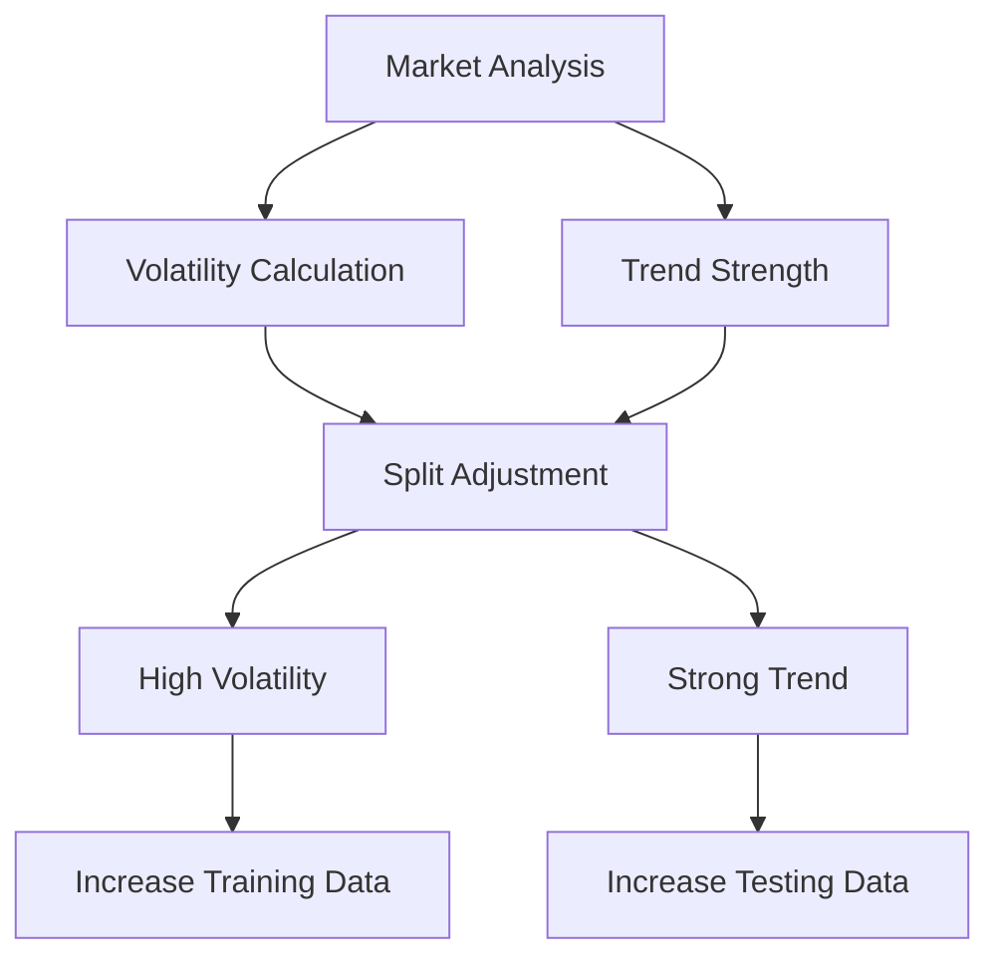
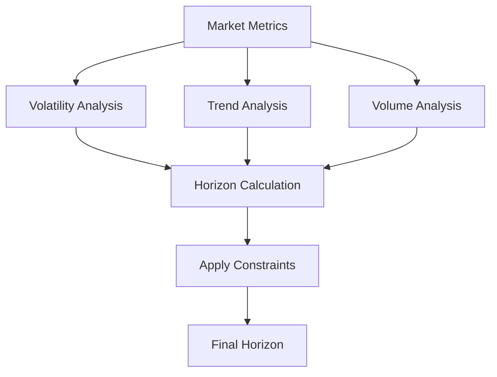

# Refined Backtesting and Prediction Parameters

## 1. Enhanced Backtesting Split Strategy

### Current Implementation
```yaml
backtesting:
  default_split: [0.7, 0.3]
  bull_split: [0.6, 0.4]
  bear_split: [0.8, 0.2]
```

### Refined Implementation

```python
class AdaptiveBacktestSplitter:
    def __init__(self):
        self.base_split = 0.7
        self.volatility_factor = 0.1
        self.trend_factor = 0.1
        
    def calculate_split(self, volatility: float, trend_strength: float) -> Tuple[float, float]:
        """
        Calculate adaptive train/test split based on market conditions
        
        Args:
            volatility: Normalized volatility (0-1 scale)
            trend_strength: Absolute trend strength (0-1 scale)
            
        Returns:
            Tuple of (train_split, test_split)
        """
        # Base split adjustment
        train_split = self.base_split
        
        # Adjust for volatility - higher volatility needs more training data
        volatility_adjustment = volatility * self.volatility_factor
        
        # Adjust for trend strength - stronger trends need less training data
        trend_adjustment = trend_strength * self.trend_factor
        
        # Calculate final split
        train_split = min(0.85, max(0.60, 
            train_split + volatility_adjustment - trend_adjustment))
        
        return (train_split, 1 - train_split)
```

### Market-Specific Adjustments



## 2. Dynamic Prediction Horizon

### Current Implementation
```yaml
prediction:
  base_horizon: 10
  max_horizon: 15
  min_horizon: 5
```

### Refined Implementation

```python
class AdaptivePredictionHorizon:
    def __init__(self):
        self.base_horizon = 10
        self.min_horizon = 3
        self.max_horizon = 20
        
        # Market condition weights
        self.volatility_weight = 0.4
        self.trend_weight = 0.3
        self.volume_weight = 0.3
        
    def calculate_horizon(self, market_metrics: Dict[str, float]) -> int:
        """
        Calculate optimal prediction horizon based on market conditions
        
        Args:
            market_metrics: Dictionary containing:
                - volatility: Historical volatility
                - trend_strength: Current trend strength
                - volume_ratio: Current volume vs average
                
        Returns:
            Optimal prediction horizon in days
        """
        # Base calculation
        horizon = self.base_horizon
        
        # Volatility adjustment (inverse relationship)
        vol_adjustment = ((1 - market_metrics['volatility']) - 0.5) * 10
        
        # Trend adjustment (positive relationship)
        trend_adjustment = (market_metrics['trend_strength'] - 0.5) * 8
        
        # Volume adjustment (positive relationship)
        volume_adjustment = (market_metrics['volume_ratio'] - 1) * 5
        
        # Weighted adjustment
        total_adjustment = (
            vol_adjustment * self.volatility_weight +
            trend_adjustment * self.trend_weight +
            volume_adjustment * self.volume_weight
        )
        
        # Calculate final horizon
        horizon = int(round(
            min(self.max_horizon, 
                max(self.min_horizon, 
                    horizon + total_adjustment))
        ))
        
        return horizon
```

### Horizon Adjustment Flow



## 3. Implementation Guidelines

### Market Condition Thresholds

```python
MARKET_THRESHOLDS = {
    'volatility': {
        'low': 0.10,    # 10% annualized volatility
        'medium': 0.20,  # 20% annualized volatility
        'high': 0.30    # 30% annualized volatility
    },
    'trend_strength': {
        'weak': 0.02,    # 2% price change
        'moderate': 0.05, # 5% price change
        'strong': 0.10   # 10% price change
    },
    'volume_ratio': {
        'low': 0.7,     # 30% below average
        'normal': 1.0,   # Average volume
        'high': 1.3     # 30% above average
    }
}
```

### Adjustment Frequency

- Backtesting splits: Re-evaluate every 21 trading days
- Prediction horizons: Re-evaluate every 5 trading days
- Emergency adjustments: Trigger on significant market events

### Performance Monitoring

```python
class ParameterPerformanceMonitor:
    def __init__(self):
        self.metrics_window = 30  # trading days
        self.performance_threshold = 0.6  # 60% accuracy minimum
        
    def evaluate_performance(self, 
                           predictions: List[float],
                           actuals: List[float],
                           current_params: Dict) -> bool:
        """
        Evaluate if current parameters are performing adequately
        """
        # Calculate prediction accuracy
        accuracy = self._calculate_accuracy(predictions, actuals)
        
        # Calculate parameter stability
        stability = self._assess_stability(current_params)
        
        # Determine if adjustment is needed
        return accuracy >= self.performance_threshold and stability
```

## 4. Risk Management Integration

### Volatility-Based Adjustments

- High volatility (>30%):
  * Reduce prediction horizon by 30%
  * Increase training data proportion by 10%
  * Increase validation frequency

- Low volatility (<10%):
  * Extend prediction horizon by 20%
  * Standard training/test split
  * Standard validation frequency

### Market Regime Changes

- Detect regime changes using:
  * 50-day moving average crossovers
  * Volatility trend changes
  * Volume pattern changes

- Adjust parameters preemptively when regime change is detected

## 5. Validation Strategy

### Cross-Validation Approach

```python
class TimeSeriesValidator:
    def __init__(self):
        self.min_train_size = 126  # 6 months
        self.validation_windows = 5
        
    def generate_validation_splits(self, data: pd.DataFrame) -> List[Tuple]:
        """
        Generate time series cross-validation splits
        """
        splits = []
        split_size = len(data) // (self.validation_windows + 1)
        
        for i in range(self.validation_windows):
            train_end = len(data) - (self.validation_windows - i) * split_size
            val_end = train_end + split_size
            
            if train_end - split_size >= self.min_train_size:
                splits.append((
                    slice(0, train_end),
                    slice(train_end, val_end)
                ))
        
        return splits
```

### Performance Metrics

Monitor these metrics for each parameter set:
1. Prediction accuracy
2. Market timing efficiency
3. Risk-adjusted returns
4. Parameter stability
5. Adaptation speed