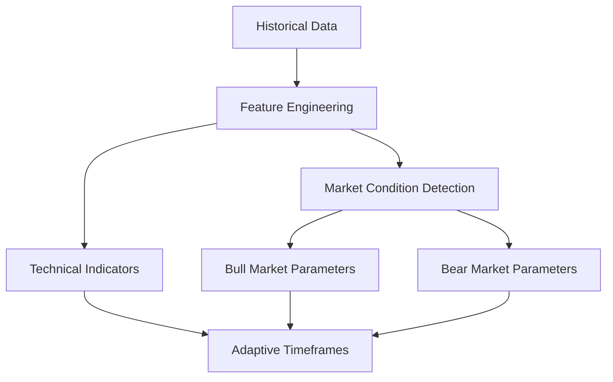
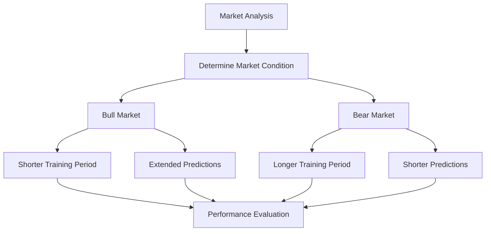

# Stock Analysis Data Parameters Recommendations

## 1. Historical Data Length for Daily Trading

### Base Recommendations
- **Minimum Length**: 60 trading days (≈ 3 months)
- **Optimal Length**: 252 trading days (1 year)
- **Ideal Length**: 504-756 trading days (2-3 years)

### Market Condition Adjustments

#### Bull Markets
- Can work with shorter periods (252-504 days) due to:
  - More consistent trends
  - Lower volatility
  - More reliable technical indicators
  - Clearer market direction

#### Bear Markets
- Require longer periods (756-1008 days) due to:
  - Higher volatility
  - More false signals
  - Need for more historical context
  - Multiple correction cycles

### Technical Basis
- Feature windows used in the system:
  - 5-day short-term momentum
  - 14-day RSI calculations
  - 20-day Bollinger Bands
  - 30-day long-term indicators

## 2. Backtesting Period Settings

### Standard Configuration
- **Training Period**: 70% of historical data
- **Testing Period**: 30% of historical data
- **Cross-validation**: 5 splits (TimeSeriesSplit)

### Market Condition Adjustments

#### Bull Markets
- Training/Testing Split: 60%/40%
  - More recent data has higher relevance
  - Trends are more likely to continue
  - Less need for extensive historical training

#### Bear Markets
- Training/Testing Split: 80%/20%
  - Need more training data to capture various downturn patterns
  - More emphasis on risk management
  - Higher importance of historical patterns

## 3. Prediction Cycles and Trend Analysis

### Default Settings
- **Forecast Horizon**: 10 trading days (2 weeks)
- **Trend Analysis Windows**:
  - Short-term: 5 days
  - Medium-term: 20 days
  - Long-term: 30 days

### Market Condition Adjustments

#### Bull Markets
- **Prediction Horizon**: Can extend to 15 trading days
- **Trend Windows**:
  - Short: 3-5 days
  - Medium: 10-15 days
  - Long: 20-25 days
- **Rationale**: Trends tend to persist longer

#### Bear Markets
- **Prediction Horizon**: Reduce to 5-7 trading days
- **Trend Windows**:
  - Short: 3 days
  - Medium: 10 days
  - Long: 30-40 days
- **Rationale**: Need faster reaction to market changes

## Implementation Considerations

### Feature Engineering

### Backtesting Strategy

## Performance Metrics by Market Condition

### Bull Markets
- Focus on capture ratio and absolute returns
- Higher emphasis on momentum indicators
- More weight on recent data

### Bear Markets
- Focus on risk-adjusted returns and maximum drawdown
- Higher emphasis on volatility indicators
- More weight on historical patterns

## Recommendations Summary

1. **Dynamic Length Adjustment**:
   - Monitor market conditions (volatility index, trend strength)
   - Adjust historical data length accordingly
   - Regular revalidation of parameters

2. **Backtesting Adaptation**:
   - Use market condition-specific splits
   - Implement separate validation for different market phases
   - Consider transition periods between conditions

3. **Prediction Cycle Optimization**:
   - Shorter cycles in high volatility
   - Extended cycles in trending markets
   - Regular recalibration based on accuracy metrics