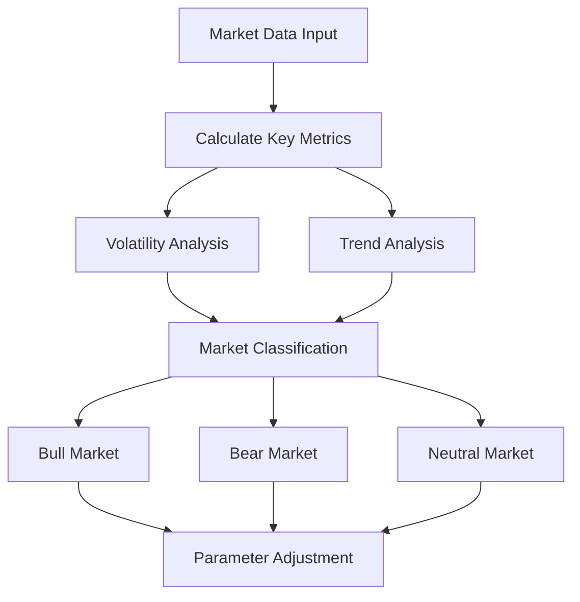
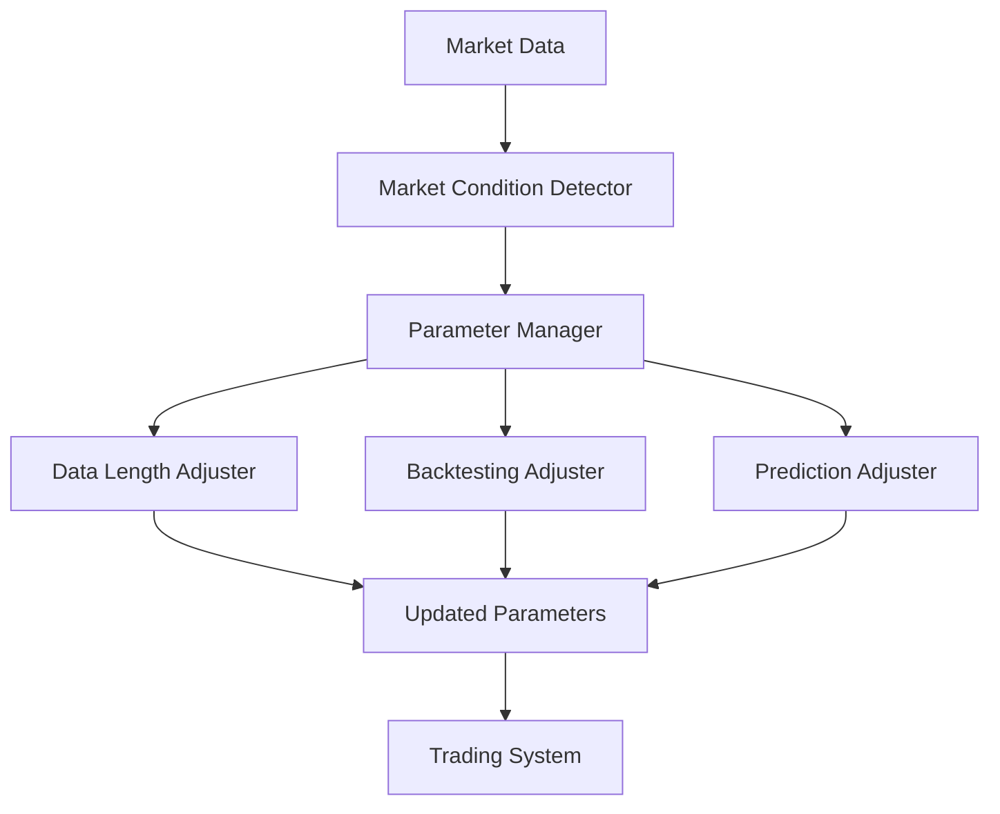
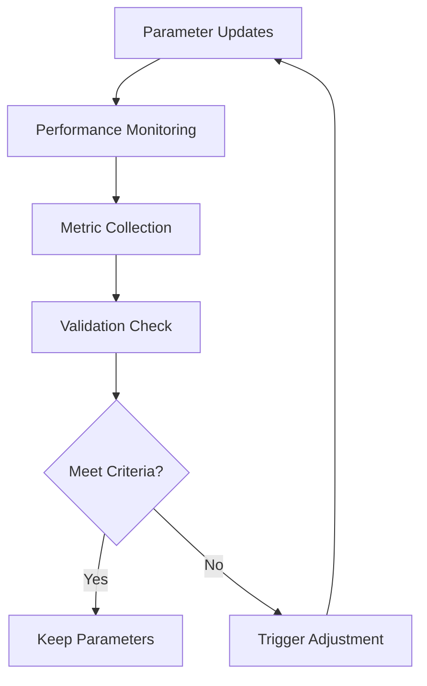

# Market Condition Detection and Parameter Adjustment Implementation Guide

## 1. Market Condition Detection System

### Key Indicators for Market Classification

```python
class MarketConditionDetector:
    def __init__(self):
        self.lookback_period = 126  # ~6 months of trading days
        self.volatility_threshold = 0.2  # 20% annualized volatility
        self.trend_threshold = 0.1  # 10% trend strength

    def detect_market_condition(self, data: pd.DataFrame) -> str:
        # Calculate key metrics
        returns = data['Close'].pct_change()
        volatility = returns.std() * np.sqrt(252)  # Annualized
        trend = (data['Close'].iloc[-1] / data['Close'].iloc[0]) - 1
        
        # Determine market condition
        if trend > self.trend_threshold and volatility < self.volatility_threshold:
            return "BULL"
        elif trend < -self.trend_threshold or volatility > self.volatility_threshold:
            return "BEAR"
        else:
            return "NEUTRAL"
```

### Implementation Flow



## 2. Dynamic Parameter Adjustment System

### Historical Data Length Adjuster

```python
class DataLengthAdjuster:
    def __init__(self):
        self.base_length = 252  # 1 year default
        self.max_length = 1008  # 4 years maximum
        self.min_length = 60    # 3 months minimum

    def calculate_optimal_length(self, market_condition: str, volatility: float) -> int:
        if market_condition == "BULL":
            return min(self.base_length * (1 + volatility), self.max_length)
        elif market_condition == "BEAR":
            return min(self.base_length * (1 + volatility * 2), self.max_length)
        else:
            return self.base_length
```

### Backtesting Period Adjuster

```python
class BacktestingAdjuster:
    def adjust_splits(self, market_condition: str) -> Tuple[float, float]:
        if market_condition == "BULL":
            return (0.6, 0.4)  # 60% training, 40% testing
        elif market_condition == "BEAR":
            return (0.8, 0.2)  # 80% training, 20% testing
        else:
            return (0.7, 0.3)  # Default split
```

### Prediction Cycle Adjuster

```python
class PredictionAdjuster:
    def adjust_horizon(self, market_condition: str, volatility: float) -> int:
        base_horizon = 10  # Default 10 days
        if market_condition == "BULL":
            return min(15, int(base_horizon * (1 + volatility)))
        elif market_condition == "BEAR":
            return max(5, int(base_horizon * (1 - volatility)))
        return base_horizon
```

## 3. Integration with Existing System

### Parameter Management System



### Implementation Steps

1. **Market Analysis Phase**
   - Monitor market conditions continuously
   - Calculate volatility and trend metrics
   - Classify market state

2. **Parameter Adjustment Phase**
   - Update historical data length
   - Modify backtesting splits
   - Adjust prediction horizons

3. **System Integration Phase**
   - Apply new parameters to trading system
   - Monitor performance metrics
   - Record parameter effectiveness

## 4. Monitoring and Validation System

### Performance Metrics

```python
class PerformanceMonitor:
    def __init__(self):
        self.metrics = {
            'prediction_accuracy': [],
            'parameter_stability': [],
            'adjustment_frequency': []
        }

    def evaluate_parameters(self, 
                          actual_returns: List[float],
                          predicted_returns: List[float],
                          current_params: Dict) -> bool:
        # Calculate performance metrics
        accuracy = calculate_accuracy(actual_returns, predicted_returns)
        stability = assess_parameter_stability(current_params)
        
        # Record metrics
        self.metrics['prediction_accuracy'].append(accuracy)
        self.metrics['parameter_stability'].append(stability)
        
        # Determine if parameters need adjustment
        return self._needs_adjustment()
```

### Validation Process



## 5. Configuration Settings

### Default Parameters

```yaml
market_detection:
  lookback_period: 126
  volatility_threshold: 0.2
  trend_threshold: 0.1

data_length:
  base_length: 252
  max_length: 1008
  min_length: 60

backtesting:
  default_split: [0.7, 0.3]
  bull_split: [0.6, 0.4]
  bear_split: [0.8, 0.2]

prediction:
  base_horizon: 10
  max_horizon: 15
  min_horizon: 5
```

## 6. Error Handling and Logging

```python
class ParameterLogger:
    def log_adjustment(self, 
                      old_params: Dict,
                      new_params: Dict,
                      market_condition: str,
                      reason: str):
        """Log parameter adjustments with context"""
        log_entry = {
            'timestamp': datetime.now(),
            'market_condition': market_condition,
            'old_params': old_params,
            'new_params': new_params,
            'adjustment_reason': reason
        }
        # Save to log storage
```

## 7. Recommended Next Steps

1. **Implementation Priority**:
   - Market condition detection system
   - Basic parameter adjustment logic
   - Monitoring and logging system
   - Advanced parameter optimization

2. **Testing Strategy**:
   - Unit tests for each component
   - Integration tests for parameter adjustments
   - Historical simulation testing
   - Real-time monitoring system

3. **Deployment Plan**:
   - Phased rollout of components
   - Parallel running with existing system
   - Performance comparison and validation
   - Full system integration