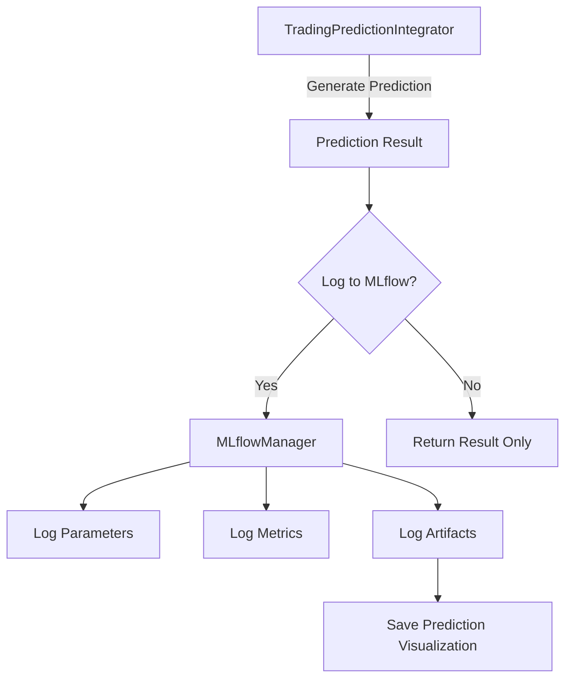
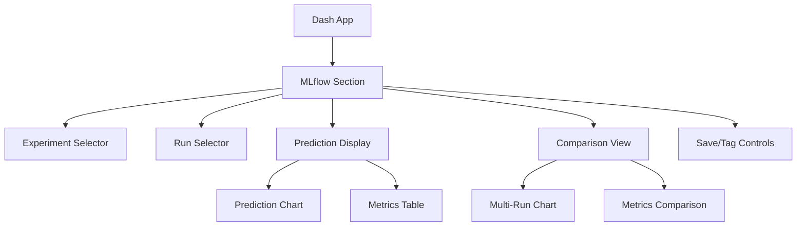
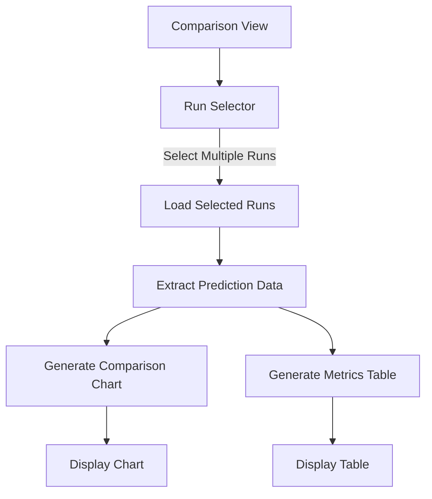
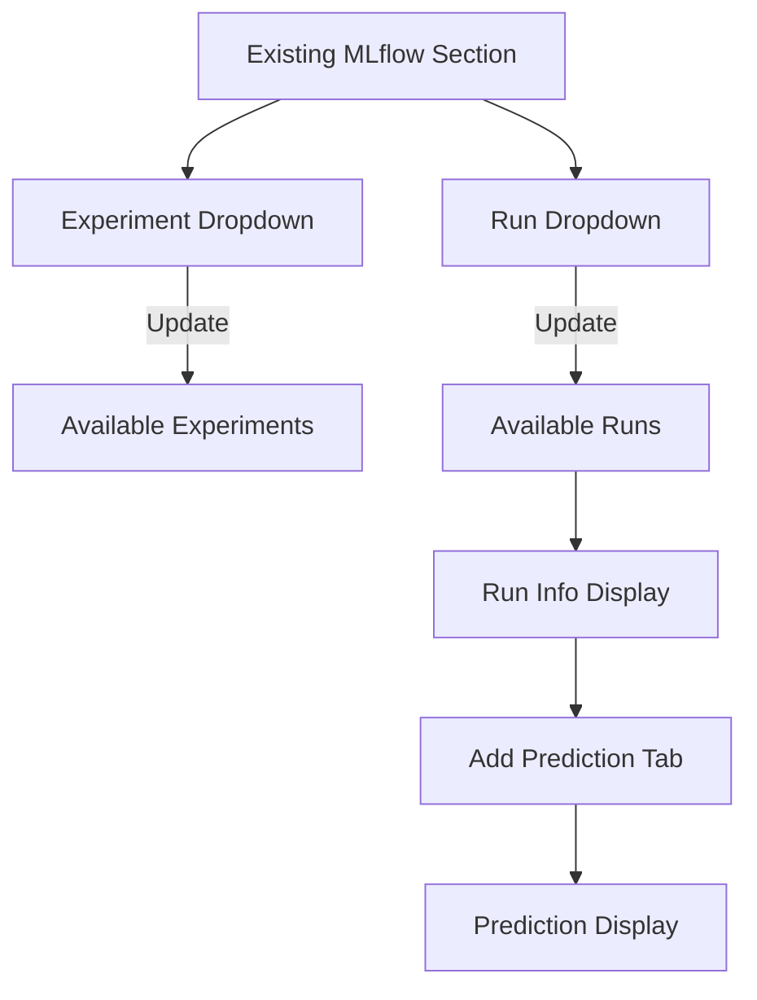

# MLflow Prediction Results Integration Plan

## Overview

This document outlines the plan to enhance the Dash interface to integrate with MLflow for displaying and comparing prediction results. The focus will be on:

1. Visual comparison of predicted vs actual stock movements from different runs
2. Comparison of buy/sell signals, confidence levels, and forecast changes across runs
3. Ability to view predictions in the dashboard and manually save/tag interesting ones for later comparison

## Current System Analysis

From reviewing the codebase, we've identified:

- The Dash interface (`dash_app.py`) already has a basic MLflow integration section (lines 459-507)
- The `TradingPredictionIntegrator` class generates predictions but doesn't save them to MLflow
- The `MLflowManager` class provides functions for logging to MLflow but isn't used for prediction results
- MLflow is configured as a remote server at `http://128.85.51.203:5000`

## Implementation Plan

### 1. Enhance Prediction Logging to MLflow



#### Steps:
1. **Modify `TradingPredictionIntegrator.generate_prediction()`**:
   - Add an optional parameter to log predictions to MLflow
   - Create a method to format prediction results for MLflow logging

2. **Create a new function in `mlflow_integration.py`**:
   - `log_prediction_result()` to handle prediction-specific logging
   - Include parameters like stock symbol, prediction date, model version
   - Log metrics like confidence level, forecast change percentage
   - Create and log visualizations comparing predicted vs actual stock movements

### 2. Enhance Dash Interface for Prediction Visualization



#### Steps:
1. **Enhance MLflow section in `dash_app.py`**:
   - Add components for displaying prediction results
   - Create a visual comparison chart for predicted vs actual stock movements
   - Add a table for displaying buy/sell signals, confidence levels, etc.

2. **Add new callbacks for prediction display**:
   - Retrieve prediction results from MLflow runs
   - Format data for visualization
   - Update charts and tables based on user selection

3. **Add save/tag functionality**:
   - Create UI elements for tagging interesting predictions
   - Add callbacks to save tags to MLflow as run tags
   - Create a view for displaying saved/tagged predictions

### 3. Create Comparison View for Multiple Runs



#### Steps:
1. **Create a new section in the Dash interface**:
   - Add multi-select dropdown for selecting MLflow runs
   - Create a comparison chart component
   - Add a metrics comparison table

2. **Add callbacks for comparison functionality**:
   - Retrieve data from multiple selected runs
   - Process and format data for comparison
   - Update comparison chart and table

### 4. Integrate with Existing MLflow Components



#### Steps:
1. **Enhance existing MLflow dropdowns**:
   - Update to include prediction-related metadata
   - Filter experiments/runs based on prediction availability

2. **Modify run info display**:
   - Add a dedicated tab for prediction results
   - Display prediction metrics and charts

## Detailed Code Changes

### 1. Modifications to `modules/mlflow_integration.py`

Add a new method to `MLflowManager` class:

```python
def log_prediction_result(self, symbol, prediction_data, actual_data=None, tags=None):
    """
    Log prediction results to MLflow.
    
    Args:
        symbol (str): Stock symbol
        prediction_data (dict): Prediction results from TradingPredictionIntegrator
        actual_data (pd.DataFrame, optional): Actual stock data for comparison
        tags (dict, optional): Additional tags for the run
    """
    # Log parameters
    params = {
        "symbol": symbol,
        "prediction_date": datetime.now().strftime('%Y-%m-%d'),
        "prediction_type": prediction_data.get('overall_action', 'Unknown')
    }
    self.log_parameters(params)
    
    # Log metrics
    metrics = {
        "confidence": prediction_data.get('confidence', 0),
        "forecast_change_percent": prediction_data.get('forecast_change_percent', 0),
        "trend": prediction_data.get('trend', 0),
        "volatility": prediction_data.get('volatility', 0)
    }
    self.log_metrics(metrics)
    
    # Create and log visualization
    if actual_data is not None:
        fig = self._create_prediction_visualization(prediction_data, actual_data)
        self.log_figure(fig, "prediction_visualization")
    
    # Log prediction data as JSON
    prediction_path = f"prediction_{datetime.now().strftime('%Y%m%d_%H%M%S')}.json"
    with open(prediction_path, "w") as f:
        json.dump(prediction_data, f)
    self.log_artifact(prediction_path)
    os.remove(prediction_path)
    
    # Add tags if provided
    if tags:
        for key, value in tags.items():
            mlflow.set_tag(key, value)
```

### 2. Modifications to `modules/trading_prediction/integration.py`

Enhance the `TradingPredictionIntegrator` class:

```python
def generate_prediction(self, data: pd.DataFrame, log_to_mlflow: bool = False, 
                       mlflow_tags: Optional[Dict[str, str]] = None) -> Dict[str, Any]:
    """
    Generate prediction for the given data and optionally log to MLflow.
    
    Args:
        data: DataFrame with OHLCV data
        log_to_mlflow: Whether to log the prediction to MLflow
        mlflow_tags: Optional tags to add to the MLflow run
            
    Returns:
        Dictionary with prediction results
    """
    # Existing prediction code...
    result = {...}  # The existing prediction result
    
    # Log to MLflow if requested
    if log_to_mlflow:
        try:
            from modules.mlflow_integration import MLflowManager
            symbol = data.name if hasattr(data, 'name') else 'unknown'
            
            mlflow_manager = MLflowManager()
            run_name = f"prediction_{symbol}_{datetime.now().strftime('%Y%m%d_%H%M%S')}"
            mlflow_manager.start_run(run_name)
            
            # Log prediction result
            mlflow_manager.log_prediction_result(symbol, result, data, mlflow_tags)
            
            # End the run
            mlflow_manager.end_run()
            
            # Add run ID to result
            result['mlflow_run_id'] = mlflow.active_run().info.run_id if mlflow.active_run() else None
            
        except Exception as e:
            logger.error(f"Error logging prediction to MLflow: {e}")
    
    return result
```

### 3. Modifications to `dash_app.py`

#### Add new components to the MLflow section:

```python
# Enhanced MLflow integration section
dbc.Row([
    dbc.Col([
        dbc.Card([
            dbc.CardHeader("MLflow Prediction Results"),
            dbc.CardBody([
                dbc.Tabs([
                    dbc.Tab(label="Current Prediction", children=[
                        dbc.Row([
                            dbc.Col([
                                html.Label("Generate Prediction:"),
                                dbc.Button("Generate New Prediction", 
                                          id="generate-prediction-button",
                                          color="primary",
                                          className="mt-2")
                            ], width=6),
                            dbc.Col([
                                html.Label("Save Prediction:"),
                                dbc.Input(id="prediction-tag-input", 
                                         placeholder="Enter tag name",
                                         type="text",
                                         className="mt-2"),
                                dbc.Button("Save to MLflow", 
                                          id="save-prediction-button",
                                          color="success",
                                          className="mt-2 ms-2")
                            ], width=6)
                        ]),
                        dbc.Row([
                            dbc.Col([
                                html.Div(id="current-prediction-info", className="mt-3")
                            ], width=12)
                        ]),
                        dbc.Row([
                            dbc.Col([
                                dcc.Graph(id="prediction-chart")
                            ], width=12)
                        ])
                    ]),
                    dbc.Tab(label="Saved Predictions", children=[
                        dbc.Row([
                            dbc.Col([
                                html.Label("Select Saved Prediction:"),
                                dcc.Dropdown(
                                    id="saved-prediction-dropdown",
                                    placeholder="Select a saved prediction",
                                    className="dropdown"
                                )
                            ], width=12)
                        ]),
                        dbc.Row([
                            dbc.Col([
                                html.Div(id="saved-prediction-info", className="mt-3")
                            ], width=12)
                        ]),
                        dbc.Row([
                            dbc.Col([
                                dcc.Graph(id="saved-prediction-chart")
                            ], width=12)
                        ])
                    ]),
                    dbc.Tab(label="Comparison", children=[
                        dbc.Row([
                            dbc.Col([
                                html.Label("Select Predictions to Compare:"),
                                dcc.Dropdown(
                                    id="comparison-dropdown",
                                    placeholder="Select predictions to compare",
                                    multi=True,
                                    className="dropdown"
                                )
                            ], width=12)
                        ]),
                        dbc.Row([
                            dbc.Col([
                                dcc.Graph(id="comparison-prediction-chart")
                            ], width=12)
                        ]),
                        dbc.Row([
                            dbc.Col([
                                html.Div(id="comparison-metrics-table", className="mt-3")
                            ], width=12)
                        ])
                    ])
                ])
            ])
        ], className="shadow")
    ], width=12)
], className="mb-4"),
```

#### Add new callbacks:

```python
@app.callback(
    Output("current-prediction-info", "children"),
    Output("prediction-chart", "figure"),
    [Input("generate-prediction-button", "n_clicks")],
    [State("stock-dropdown", "value"),
     State("date-picker", "start_date"),
     State("date-picker", "end_date")]
)
def generate_and_display_prediction(n_clicks, symbol, start_date, end_date):
    """Generate and display a new prediction."""
    if not n_clicks or not symbol:
        return html.P("Click 'Generate New Prediction' to create a prediction"), go.Figure()
    
    # Get stock data
    df = get_stock_data(symbol, start_date, end_date)
    if df.empty:
        return html.P(f"No data available for {symbol}"), go.Figure()
    
    # Generate prediction
    from modules.trading_prediction.integration import get_trading_prediction
    df.name = symbol  # Set name attribute for the dataframe
    prediction = get_trading_prediction(symbol, df)
    
    # Create prediction info
    info_card = dbc.Card([
        dbc.CardHeader("Prediction Information"),
        dbc.CardBody([
            html.P(f"Symbol: {symbol}"),
            html.P(f"Date: {datetime.now().strftime('%Y-%m-%d %H:%M:%S')}"),
            html.P(f"Action: {prediction['overall_action']}"),
            html.P(f"Confidence: {prediction['confidence']:.2f}"),
            html.P(f"Forecast Change: {prediction['forecast_change_percent']:.2f}%"),
            html.P(f"Trend: {prediction['trend']:.2f}"),
            html.P(f"Volatility: {prediction['volatility']:.2f}")
        ])
    ])
    
    # Create prediction chart
    fig = create_prediction_chart(df, prediction)
    
    return info_card, fig

@app.callback(
    Output("saved-prediction-dropdown", "options"),
    [Input("save-prediction-button", "n_clicks")],
    [State("stock-dropdown", "value"),
     State("prediction-tag-input", "value")]
)
def save_prediction_to_mlflow(n_clicks, symbol, tag):
    """Save the current prediction to MLflow with a tag."""
    if not n_clicks or not symbol or not tag:
        # Just return the current saved predictions
        return get_saved_predictions()
    
    # Get stock data
    start_date = (datetime.now() - timedelta(days=90)).strftime('%Y-%m-%d')
    end_date = datetime.now().strftime('%Y-%m-%d')
    df = get_stock_data(symbol, start_date, end_date)
    if df.empty:
        return get_saved_predictions()
    
    # Generate prediction and log to MLflow
    from modules.trading_prediction.integration import get_trading_prediction
    df.name = symbol
    prediction = get_trading_prediction(symbol, df, log_to_mlflow=True, 
                                       mlflow_tags={"tag": tag, "saved_by_user": "true"})
    
    # Return updated saved predictions
    return get_saved_predictions()

def get_saved_predictions():
    """Get list of saved predictions from MLflow."""
    import mlflow
    
    try:
        # Set MLflow tracking URI
        mlflow_config = get_mlflow_config()
        mlflow.set_tracking_uri(mlflow_config["tracking_uri"])
        
        # Get experiment ID
        experiment = mlflow.get_experiment_by_name(mlflow_config["experiment_name"])
        if not experiment:
            return []
        
        # Get runs with "saved_by_user" tag
        runs = mlflow.search_runs(
            experiment_ids=[experiment.experiment_id],
            filter_string="tags.saved_by_user = 'true'"
        )
        
        # Format options for dropdown
        options = []
        for _, run in runs.iterrows():
            run_id = run["run_id"]
            symbol = run["params.symbol"] if "params.symbol" in run else "Unknown"
            tag = run["tags.tag"] if "tags.tag" in run else "Untitled"
            date = run["start_time"].split(" ")[0] if "start_time" in run else "Unknown"
            
            options.append({
                "label": f"{symbol} - {tag} ({date})",
                "value": run_id
            })
        
        return options
    except Exception as e:
        print(f"Error getting saved predictions: {e}")
        return []

@app.callback(
    Output("saved-prediction-info", "children"),
    Output("saved-prediction-chart", "figure"),
    [Input("saved-prediction-dropdown", "value")]
)
def display_saved_prediction(run_id):
    """Display a saved prediction from MLflow."""
    if not run_id:
        return html.P("Select a saved prediction to view"), go.Figure()
    
    import mlflow
    
    try:
        # Set MLflow tracking URI
        mlflow_config = get_mlflow_config()
        mlflow.set_tracking_uri(mlflow_config["tracking_uri"])
        
        # Get run data
        run = mlflow.get_run(run_id)
        
        # Extract prediction info
        params = run.data.params
        metrics = run.data.metrics
        tags = run.data.tags
        
        # Create prediction info card
        info_card = dbc.Card([
            dbc.CardHeader("Saved Prediction"),
            dbc.CardBody([
                html.P(f"Symbol: {params.get('symbol', 'Unknown')}"),
                html.P(f"Date: {params.get('prediction_date', 'Unknown')}"),
                html.P(f"Action: {params.get('prediction_type', 'Unknown')}"),
                html.P(f"Confidence: {metrics.get('confidence', 0):.2f}"),
                html.P(f"Forecast Change: {metrics.get('forecast_change_percent', 0):.2f}%"),
                html.P(f"Trend: {metrics.get('trend', 0):.2f}"),
                html.P(f"Volatility: {metrics.get('volatility', 0):.2f}"),
                html.P(f"Tag: {tags.get('tag', 'Untitled')}")
            ])
        ])
        
        # Get the prediction visualization from artifacts
        client = mlflow.tracking.MlflowClient()
        artifacts = client.list_artifacts(run_id)
        
        # Create a figure from the saved artifact or a placeholder
        fig = go.Figure()
        for artifact in artifacts:
            if artifact.path == "prediction_visualization.png":
                # Download the artifact
                local_path = client.download_artifacts(run_id, "prediction_visualization.png")
                # Create a figure from the image
                fig = px.imshow(plt.imread(local_path))
                break
        
        return info_card, fig
    except Exception as e:
        print(f"Error displaying saved prediction: {e}")
        return html.P(f"Error: {str(e)}"), go.Figure()

def create_prediction_chart(df, prediction):
    """Create a chart visualizing the prediction."""
    # Create figure
    fig = make_subplots(rows=1, cols=1)
    
    # Add historical price
    fig.add_trace(
        go.Scatter(
            x=df.index,
            y=df['Close'],
            name="Historical Price",
            line=dict(color='blue')
        )
    )
    
    # Add prediction
    last_date = df.index[-1]
    forecast_dates = [last_date + timedelta(days=i) for i in range(1, 6)]
    
    # Calculate predicted prices
    last_price = df['Close'].iloc[-1]
    forecast_change = prediction['forecast_change_percent'] / 100
    predicted_price = last_price * (1 + forecast_change)
    
    # Create a simple linear path from last price to predicted price
    predicted_prices = [last_price]
    for i in range(1, 6):
        step_change = last_price * (forecast_change * i / 5)
        predicted_prices.append(last_price + step_change)
    
    # Add prediction line
    fig.add_trace(
        go.Scatter(
            x=[last_date] + forecast_dates,
            y=predicted_prices,
            name="Prediction",
            line=dict(color='red', dash='dash')
        )
    )
    
    # Add confidence interval
    upper_bound = [price * (1 + prediction['volatility']) for price in predicted_prices]
    lower_bound = [price * (1 - prediction['volatility']) for price in predicted_prices]
    
    fig.add_trace(
        go.Scatter(
            x=[last_date] + forecast_dates,
            y=upper_bound,
            name="Upper Bound",
            line=dict(color='rgba(255,0,0,0.2)', dash='dot'),
            showlegend=False
        )
    )
    
    fig.add_trace(
        go.Scatter(
            x=[last_date] + forecast_dates,
            y=lower_bound,
            name="Lower Bound",
            line=dict(color='rgba(255,0,0,0.2)', dash='dot'),
            fill='tonexty',
            fillcolor='rgba(255,0,0,0.1)',
            showlegend=False
        )
    )
    
    # Add action markers
    for i, action in enumerate(prediction['daily_actions']):
        if action.lower() == 'buy':
            fig.add_trace(
                go.Scatter(
                    x=[forecast_dates[i]],
                    y=[predicted_prices[i+1]],
                    mode='markers',
                    marker=dict(symbol='triangle-up', size=12, color='green'),
                    name="Buy Signal"
                )
            )
        elif action.lower() == 'sell':
            fig.add_trace(
                go.Scatter(
                    x=[forecast_dates[i]],
                    y=[predicted_prices[i+1]],
                    mode='markers',
                    marker=dict(symbol='triangle-down', size=12, color='red'),
                    name="Sell Signal"
                )
            )
    
    # Update layout
    fig.update_layout(
        title=f"Stock Price Prediction",
        xaxis_title="Date",
        yaxis_title="Price",
        template="plotly_dark",
        height=500
    )
    
    return fig
```

## Implementation Timeline

1. **Phase 1: MLflow Integration Enhancement (1-2 days)**
   - Modify MLflowManager to add prediction logging capabilities
   - Update TradingPredictionIntegrator to log predictions to MLflow
   - Test the logging functionality

2. **Phase 2: Dash Interface Updates (2-3 days)**
   - Add new components to the MLflow section in dash_app.py
   - Implement callbacks for generating and displaying predictions
   - Create visualization functions for predictions

3. **Phase 3: Saved Predictions and Comparison (2-3 days)**
   - Implement saving/tagging functionality
   - Create the comparison view for multiple predictions
   - Add callbacks for retrieving and displaying saved predictions

4. **Phase 4: Testing and Refinement (1-2 days)**
   - Test all functionality
   - Refine UI elements and visualizations
   - Fix any bugs or issues

## Benefits of This Approach

1. **Seamless Integration**: Builds on the existing MLflow integration in the Dash app
2. **Flexible Comparison**: Allows users to compare multiple prediction runs
3. **Visual Analysis**: Provides clear visualizations of predicted vs actual stock movements
4. **User Control**: Enables manual saving and tagging of interesting predictions
5. **Extensible**: Can be easily extended to include additional metrics or visualizations

## Potential Challenges

1. **MLflow Server Performance**: Retrieving and comparing multiple runs might be slow if the MLflow server is under heavy load
2. **Data Synchronization**: Ensuring that saved predictions are correctly linked to actual stock data
3. **UI Responsiveness**: The comparison view might become cluttered with many runs selected