# Stock Trading Prediction Model Implementation Plan

## Table of Contents
1. [Overview](#overview)
2. [System Architecture](#system-architecture)
3. [Module Structure](#module-structure)
4. [Detailed Component Design](#detailed-component-design)
   - [Data Acquisition Component](#data-acquisition-component)
   - [Feature Engineering Pipeline](#feature-engineering-pipeline)
   - [Model Architectures](#model-architectures)
   - [Market Hours and Trading Calendar Management](#market-hours-and-trading-calendar-management)
   - [Hyperparameter Optimization](#hyperparameter-optimization)
   - [Enhanced MLflow Integration](#enhanced-mlflow-integration)
   - [Backtesting Framework](#backtesting-framework)
   - [Model Interpretability](#model-interpretability)
5. [Implementation Roadmap](#implementation-roadmap)
6. [Testing Strategy](#testing-strategy)
7. [Evaluation Criteria](#evaluation-criteria)
8. [Technology Stack](#technology-stack)
9. [Potential Challenges and Mitigations](#potential-challenges-and-mitigations)

## Overview

This document outlines the implementation plan for a comprehensive stock trading prediction model that treats the problem as a time series classification task. The model will predict buy/sell/hold signals based on historical market data, with the following key features:

- Market-agnostic design with initial testing on US and Chinese markets
- Support for both PyTorch and TensorFlow implementations
- Multiple model architectures (LSTM/GRU and Transformer-based)
- Enhanced feature engineering for technical indicators and macroeconomic data
- Improved backtesting with proper cross-validation techniques
- Model interpretability features

The core approach is to leverage deep learning techniques, particularly LSTM/GRU and Transformer architectures, to analyze historical market data and predict future trading signals. The model will be designed to be flexible, interpretable, and capable of handling different market conditions.

## System Architecture

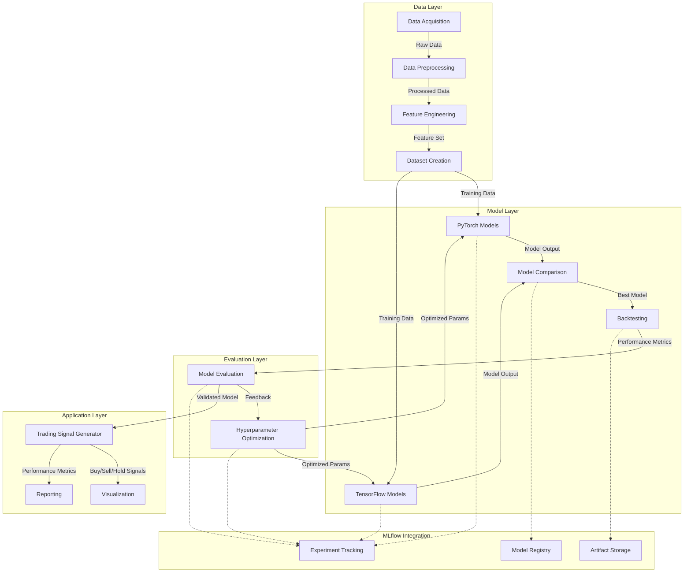

The system is designed with four main layers:

1. **Data Layer**: Responsible for acquiring, preprocessing, and engineering features from raw market data.
2. **Model Layer**: Implements and trains various model architectures in both PyTorch and TensorFlow.
3. **Evaluation Layer**: Evaluates model performance through backtesting and optimizes hyperparameters.
4. **Application Layer**: Generates trading signals and visualizes results.

The system also integrates with MLflow for experiment tracking, model registry, and artifact storage.

## Module Structure

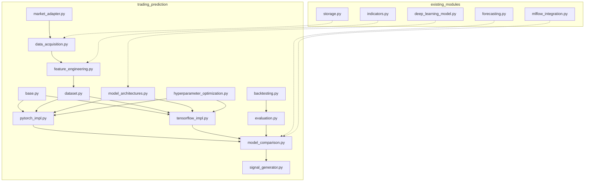

We'll create a new module called `trading_prediction` that integrates with the existing codebase. The module will consist of several Python files, each responsible for a specific aspect of the system:

- `base.py`: Abstract base classes and interfaces
- `pytorch_impl.py`: PyTorch implementation of models
- `tensorflow_impl.py`: TensorFlow implementation of models
- `data_acquisition.py`: Data acquisition from various sources
- `feature_engineering.py`: Feature engineering pipeline
- `dataset.py`: Dataset creation and management
- `model_architectures.py`: Model architecture definitions
- `model_comparison.py`: Model comparison utilities
- `signal_generator.py`: Trading signal generation
- `backtesting.py`: Backtesting framework
- `evaluation.py`: Model evaluation utilities
- `hyperparameter_optimization.py`: Hyperparameter optimization
- `market_adapter.py`: Market-specific adapters

The module will integrate with existing modules in the codebase, leveraging functionality from `deep_learning_model.py`, `forecasting.py`, `indicators.py`, `storage.py`, and `mlflow_integration.py`.

## Detailed Component Design

### Data Acquisition Component

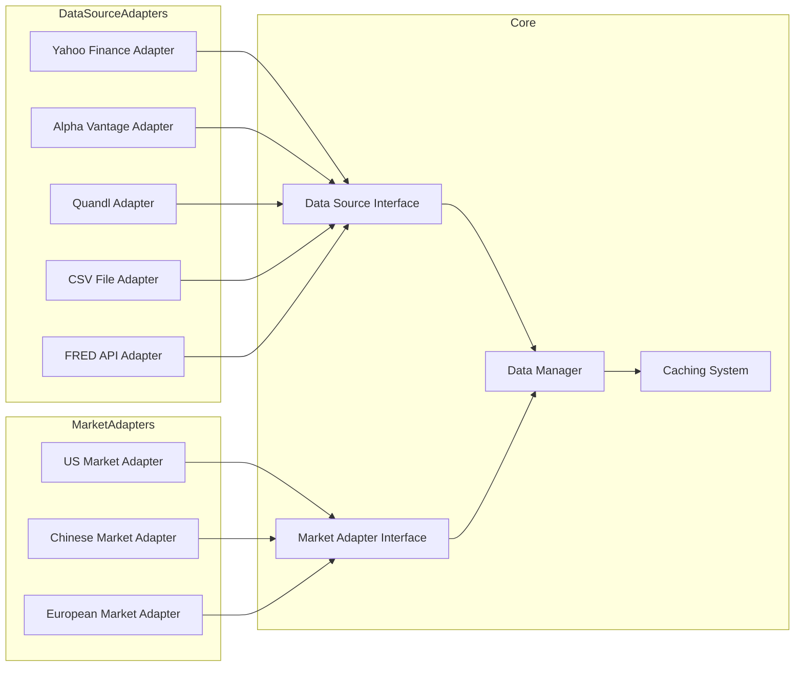

The data acquisition component will provide a unified interface for fetching data from various sources. Key features include:

- **Data Source Adapters**:
  - Yahoo Finance adapter (already in the codebase)
  - Alpha Vantage adapter
  - Quandl adapter
  - CSV file adapter
  - FRED API adapter for macroeconomic data

- **Market Adapters**:
  - US market adapter
  - Chinese market adapter
  - European market adapter (extensible)

- **Core Components**:
  - Data source interface
  - Market adapter interface
  - Data manager
  - Caching system to minimize API calls

- **Functionality**:
  - Fetch historical price and volume data
  - Fetch macroeconomic indicators
  - Handle different data frequencies
  - Normalize data formats across sources
  - Cache data to avoid redundant API calls

### Feature Engineering Pipeline

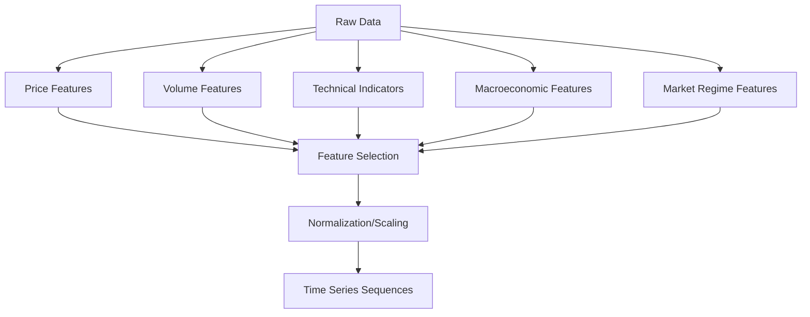

The feature engineering pipeline will transform raw market data into features suitable for deep learning models. Features will include:

- **Price-based Features**:
  - Returns: Daily returns, log returns
  - Moving averages: Simple Moving Average (SMA), Exponential Moving Average (EMA)
  - Price momentum: Rate of change over different time periods
  - Price volatility: Standard deviation of returns

- **Volume-based Features**:
  - Volume changes: Daily volume changes, normalized volume
  - On-Balance Volume (OBV)
  - Volume-price correlation
  - Volume momentum

- **Technical Indicators**:
  - Relative Strength Index (RSI)
  - Moving Average Convergence Divergence (MACD)
  - Bollinger Bands
  - Average True Range (ATR)
  - Stochastic Oscillator

- **Macroeconomic Features**:
  - Interest rates
  - GDP growth
  - Inflation rates
  - Unemployment rates

- **Market Regime Features**:
  - Volatility regimes
  - Trend strength
  - Market phases (bull, bear, sideways)

The pipeline will also include:
- Feature selection to identify most predictive features
- Normalization/scaling to prepare data for neural networks
- Time series sequence creation for LSTM/GRU and Transformer models

### Model Architectures

We'll implement multiple model architectures in both PyTorch and TensorFlow:

#### LSTM/GRU-based Models:
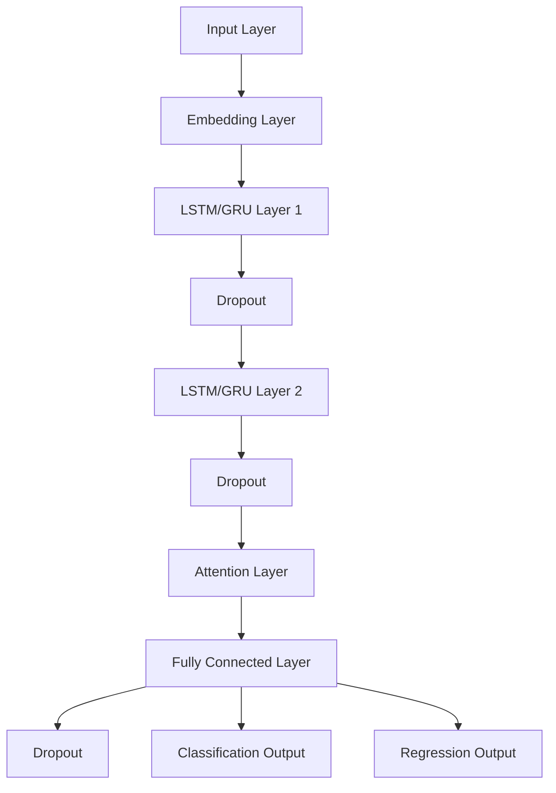

The LSTM/GRU models will include:
- Input layer for time series data
- Embedding layer to project features into a higher-dimensional space
- Multiple LSTM/GRU layers with dropout for regularization
- Attention mechanism to focus on important time steps
- Fully connected layers for final processing
- Dual output heads for classification (buy/sell/hold) and regression (price prediction)

#### Transformer-based Models:
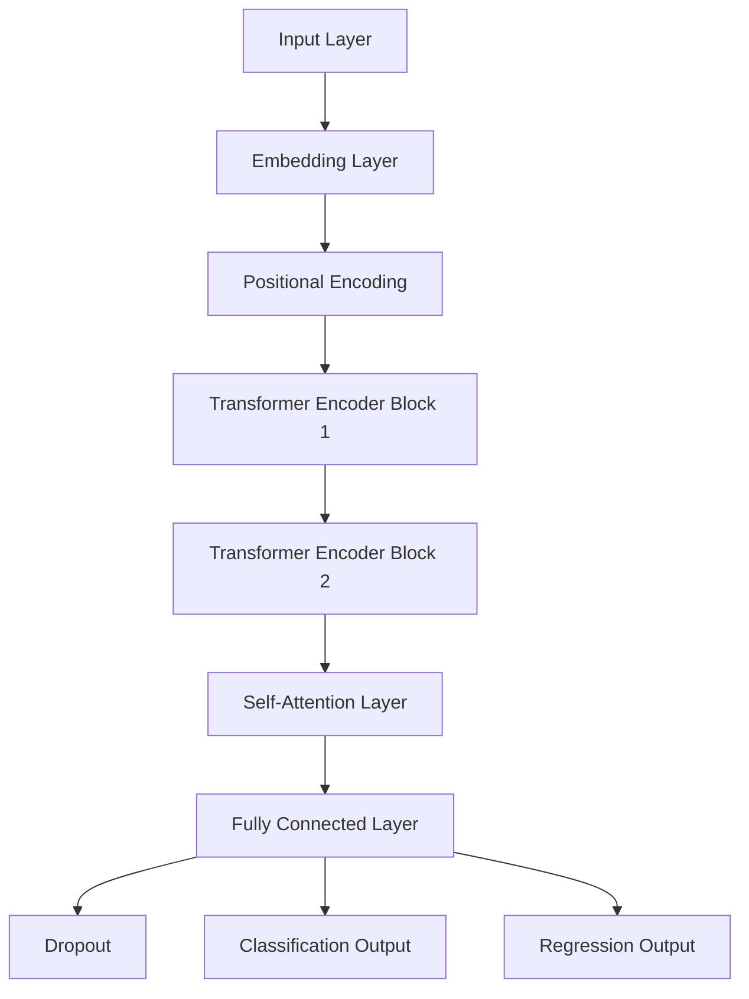

The Transformer models will include:
- Input layer for time series data
- Embedding layer with positional encoding
- Multiple Transformer encoder blocks
- Self-attention mechanism
- Fully connected layers for final processing
- Dual output heads for classification and regression

Both model types will be implemented in PyTorch and TensorFlow with compatible APIs to facilitate fair comparison.

### Market Hours and Trading Calendar Management

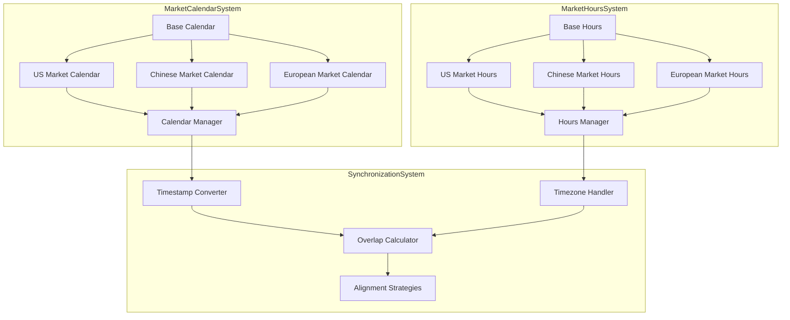

To handle different market hours and trading calendars between US and Chinese markets, we'll implement:

1. **Trading Days Management**:
   - US markets: NYSE and NASDAQ calendars (closed on weekends and US holidays)
   - Chinese markets: SSE and SZSE calendars (closed on weekends and Chinese holidays)
   - Special events (early closings, unexpected market closures)

2. **Holiday Database**:
   - Market-specific holiday calendars
   - Regular holidays (e.g., New Year's Day, Christmas)
   - Lunar calendar holidays (especially for Chinese markets)
   - Special non-trading days (e.g., national mourning days)

3. **Market Hours Handling**:
   - US markets: 9:30 AM - 4:00 PM ET
   - Chinese markets: 9:30 AM - 11:30 AM and 1:00 PM - 3:00 PM CST
   - Pre-market and after-hours sessions where applicable

4. **Timezone Management**:
   - Convert all timestamps to UTC internally
   - Provide market-local time conversion utilities
   - Handle daylight saving time transitions (particularly for US markets)

5. **Data Alignment Strategies**:
   - Daily data: Align by calendar date with proper offset handling
   - Intraday data: Align by specific time points with timezone conversion
   - Session-based alignment for corresponding sessions across markets
   - Gap handling for holidays and weekends

6. **US-China Specific Considerations**:
   - ~12-13 hour time difference (depending on DST)
   - Minimal to no overlapping trading hours
   - Different holiday systems (Western vs. Lunar calendar)
   - Weekend definition is similar (Saturday-Sunday)

This system will ensure that our models can properly handle the temporal aspects of multi-market data, which is crucial for accurate prediction and backtesting.

### Hyperparameter Optimization

We'll implement a two-stage approach to hyperparameter optimization:

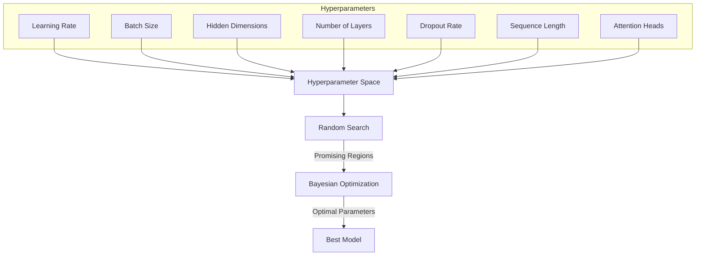

1. **Random Search**:
   - Initial broad exploration of hyperparameter space
   - Efficient sampling of large parameter spaces
   - Identification of promising regions

2. **Bayesian Optimization**:
   - Focused optimization around promising configurations
   - Efficient exploration-exploitation trade-off
   - Probabilistic model of the objective function

Key hyperparameters to optimize include:
- Learning rate
- Batch size
- Hidden dimensions
- Number of layers
- Dropout rate
- Sequence length
- Number of attention heads (for Transformer models)

The optimization process will be integrated with MLflow for tracking and visualization of results.

### Enhanced MLflow Integration

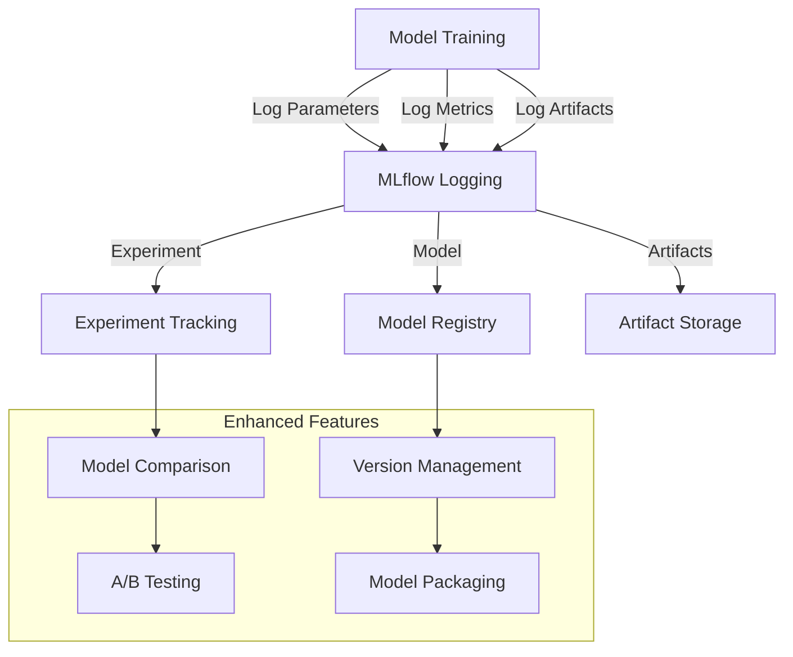

We'll enhance the existing MLflow integration with:

1. **Improved Version Management**:
   - Market-specific tagging for models
   - Versioning based on data ranges
   - Automated transition between staging and production

2. **Enhanced Model Comparison**:
   - Side-by-side comparison of PyTorch and TensorFlow models
   - Performance visualization across different markets
   - Feature importance comparison

3. **A/B Testing Framework**:
   - Automated A/B testing of model versions
   - Statistical significance testing
   - Performance difference visualization

4. **Model Packaging**:
   - Export models for production deployment
   - Create self-contained prediction packages
   - Support for ONNX format for cross-platform compatibility

### Backtesting Framework

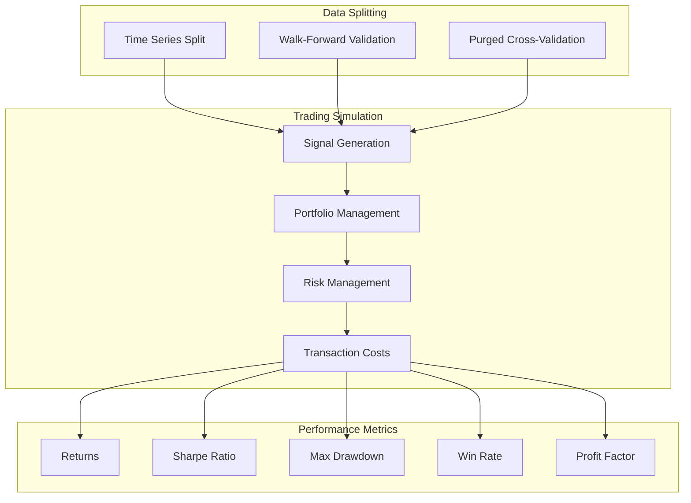

We'll enhance the backtesting framework with:

1. **Advanced Data Splitting**:
   - Time series cross-validation
   - Walk-forward optimization
   - Purged cross-validation to prevent data leakage

2. **Realistic Trading Simulation**:
   - Signal generation based on model predictions
   - Portfolio management with position sizing
   - Risk management rules
   - Transaction costs and slippage modeling

3. **Comprehensive Performance Metrics**:
   - Returns (total, annualized)
   - Risk-adjusted metrics (Sharpe, Sortino, Calmar ratios)
   - Maximum drawdown
   - Win rate and profit factor
   - Market-specific performance comparisons

4. **Market-Specific Backtesting Rules**:
   - Different transaction cost models for each market
   - Market-specific trading restrictions
   - Handling of market-specific events

### Model Interpretability

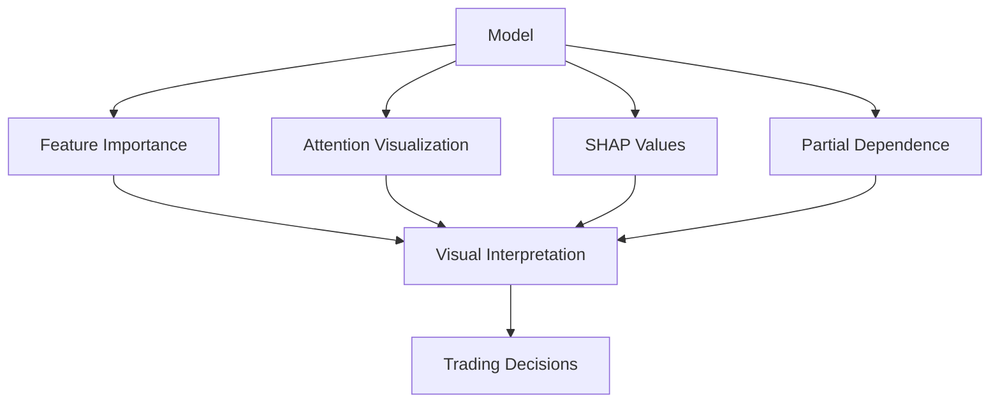

We'll implement several techniques for model interpretability:

1. **Global Feature Importance**:
   - Permutation importance
   - Integrated gradients
   - Feature attribution analysis

2. **Attention Visualization**:
   - Heatmaps of attention weights
   - Time step importance visualization
   - Feature-to-feature attention analysis

3. **SHAP (SHapley Additive exPlanations) Values**:
   - Individual prediction explanation
   - Feature contribution analysis
   - Decision path visualization

4. **Partial Dependence Plots**:
   - Relationship between features and predictions
   - Interaction effects between features
   - Market-specific feature impact analysis

5. **Counterfactual Explanations**:
   - "What-if" scenarios for predictions
   - Threshold analysis for signal changes
   - Sensitivity analysis

These interpretability techniques will help users understand why the model makes specific trading recommendations, increasing trust and facilitating model improvement.

## Implementation Roadmap

### Phase 1: Foundation (3-4 weeks)
1. Set up module structure and interfaces
2. Implement data acquisition with market adapters
   - US market adapter
   - Chinese market adapter
3. Develop feature engineering pipeline
4. Create dataset preparation and time series splitting utilities
5. Enhance MLflow integration with versioning capabilities
6. Implement market hours and trading calendar management

### Phase 2: Model Development (4-5 weeks)
1. Implement base model interfaces
2. Develop PyTorch implementations:
   - LSTM/GRU models with attention
   - Transformer models
3. Develop TensorFlow implementations:
   - LSTM/GRU models with attention
   - Transformer models
4. Create training pipeline with early stopping and learning rate scheduling
5. Implement random search hyperparameter optimization

### Phase 3: Evaluation & Optimization (3-4 weeks)
1. Implement enhanced backtesting framework
2. Develop model comparison utilities
3. Create visualization tools for model performance
4. Implement Bayesian optimization for hyperparameter tuning
5. Add model interpretability features
6. Develop market-specific evaluation metrics

### Phase 4: Integration & Refinement (2-3 weeks)
1. Integrate with existing forecasting and backtesting modules
2. Implement signal generation logic
3. Create comprehensive documentation
4. Develop example notebooks and tutorials
5. Optimize performance for production use
6. Conduct final testing across multiple markets

## Testing Strategy

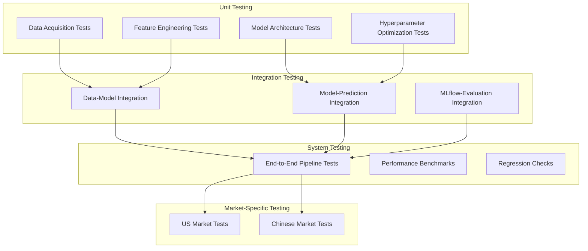

Our testing strategy will include:

1. **Unit Testing**:
   - Data acquisition component tests
   - Feature engineering pipeline tests
   - Model architecture tests
   - Hyperparameter optimization tests

2. **Integration Testing**:
   - Data-model integration tests
   - Model-prediction integration tests
   - MLflow-evaluation integration tests

3. **System Testing**:
   - End-to-end pipeline tests
   - Performance benchmarks
   - Regression checks

4. **Market-Specific Testing**:
   - US market-specific tests
   - Chinese market-specific tests
   - Cross-market integration tests

We'll use pytest for unit and integration testing, with continuous integration to ensure code quality throughout the development process.

## Evaluation Criteria

We'll evaluate the success of the implementation based on:

1. **Classification Performance**:
   - Precision, recall, F1-score for buy/sell/hold signals
   - Confusion matrix analysis
   - ROC curves and AUC
   - Classification accuracy over different time horizons

2. **Trading Performance**:
   - Returns (total, annualized)
   - Risk-adjusted metrics (Sharpe, Sortino, Calmar ratios)
   - Maximum drawdown
   - Win rate and profit factor
   - Performance consistency across different market conditions

3. **Technical Performance**:
   - Training speed (time per epoch)
   - Inference speed (predictions per second)
   - Memory usage
   - Scaling with dataset size
   - Deployment efficiency

4. **Framework Comparison**:
   - PyTorch vs TensorFlow performance
   - LSTM/GRU vs Transformer architecture comparison
   - Market-specific performance differences
   - Feature importance consistency across frameworks

5. **Interpretability Quality**:
   - Consistency of explanations
   - Actionability of insights
   - User understanding of model decisions
   - Ability to detect and explain model failures

## Technology Stack

- **Languages**: Python 3.8+
- **Deep Learning**: PyTorch, TensorFlow
- **Data Processing**: Pandas, NumPy
- **Feature Engineering**: TA-Lib, scikit-learn
- **Visualization**: Matplotlib, Seaborn, Plotly
- **Experiment Tracking**: MLflow (enhanced)
- **Storage**: InfluxDB (time series data)
- **API Integration**: Requests, APIs for financial data
- **Hyperparameter Optimization**: Optuna, Hyperopt
- **Model Interpretability**: SHAP, Captum, TF-Explain
- **Testing**: pytest, hypothesis
- **Documentation**: Sphinx, MkDocs

## Potential Challenges and Mitigations

1. **Data Quality Issues**:
   - **Challenge**: Inconsistent or missing data across different markets and sources
   - **Mitigation**: Implement robust data validation, create fallback mechanisms for missing data, develop market-specific data cleaning rules

2. **Model Overfitting**:
   - **Challenge**: Models may overfit to historical patterns that don't generalize
   - **Mitigation**: Use proper time series cross-validation, implement regularization techniques, monitor validation performance during training

3. **Market-Specific Differences**:
   - **Challenge**: Different markets may have unique characteristics that affect model performance
   - **Mitigation**: Design flexible market adapters, implement market-specific feature engineering, create separate evaluation metrics for each market

4. **Computational Resources**:
   - **Challenge**: Training deep learning models on large datasets requires significant computational resources
   - **Mitigation**: Implement efficient data loading with caching, use mixed-precision training where applicable, support distributed training for large models

5. **Model Interpretability Challenges**:
   - **Challenge**: Deep learning models are often considered "black boxes"
   - **Mitigation**: Focus on actionable insights over complex explanations, combine multiple interpretability techniques, create market-specific interpretation guidelines

6. **Calendar and Time Zone Complexities**:
   - **Challenge**: Handling different market hours, holidays, and time zones
   - **Mitigation**: Implement robust calendar and time zone management, use UTC internally for all timestamps, create market-specific adapters

7. **Deployment Challenges**:
   - **Challenge**: Moving from research to production can be difficult
   - **Mitigation**: Design with deployment in mind, use MLflow for model packaging, support ONNX format for cross-platform compatibility