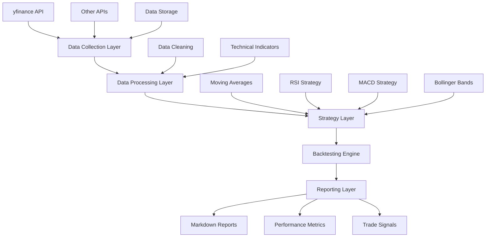

## System Architecture



## Implementation Plan

### 1. Data Collection Module
- **API Integration**
  - yfinance API implementation
  - Support for multiple exchanges (NYSE/NASDAQ/HKEX/ASX)
  - Extensible design for adding new data sources
- **Data Storage**
  - JSON-based storage structure
  - Efficient data retrieval system
  - Data update and synchronization mechanism

### 2. Data Processing Module
- **Data Cleaning**
  - Handle missing data
  - Adjust for stock splits and dividends
  - Data validation and quality checks
- **Technical Indicators**
  - Moving Averages (SMA, EMA)
  - Relative Strength Index (RSI)
  - Moving Average Convergence Divergence (MACD)
  - Bollinger Bands
  - Volume indicators

### 3. Strategy Module
- **Base Strategy Framework**
  - Abstract strategy class
  - Signal generation interface
  - Risk management rules
- **Technical Indicator Strategies**
  - Moving Average crossover strategy
  - RSI overbought/oversold signals
  - MACD signal line crossovers
  - Bollinger Bands mean reversion
- **Composite Strategy**
  - Multiple indicator combination
  - Weighted signal generation
  - Strategy optimization capabilities

### 4. Backtesting Engine
- **Core Features**
  - Historical data simulation
  - Position sizing rules
  - Transaction cost consideration
  - Risk management implementation
- **Performance Metrics**
  - Total returns calculation
  - Sharpe ratio
  - Maximum drawdown
  - Win/loss ratio
  - Risk-adjusted returns

### 5. Reporting Module
- **Report Generation**
  - Markdown format reports
  - Performance metrics summary
  - Trade signals log
  - Position history
- **Visualizations**
  - Price charts with indicators
  - Performance charts
  - Drawdown analysis
  - Risk metrics visualization

## Project Structure
```
stock_trading_system/
├── data/
│   ├── fetchers/           # Data collection implementations
│   ├── processors/         # Data processing and cleaning
│   └── storage/           # Data storage management
├── strategies/
│   ├── indicators/        # Technical indicators
│   ├── base.py           # Base strategy class
│   └── composite.py      # Composite strategy implementation
├── backtesting/
│   ├── engine.py         # Backtesting core
│   └── performance.py    # Performance calculations
├── reporting/
│   ├── generator.py      # Report generation
│   └── templates/        # Report templates
└── config/               # Configuration files
```

## Implementation Steps

1. Set up project structure and dependencies
2. Implement data collection module
3. Develop technical indicators and data processing
4. Create strategy framework and implementations
5. Build backtesting engine
6. Develop reporting system
7. Testing and optimization
8. Documentation and deployment

## Technologies to Use
- Python 3.8+
- pandas for data manipulation
- numpy for numerical computations
- yfinance for data collection
- matplotlib/plotly for visualizations
- markdown for report generation

## Future Enhancements
- Real-time data streaming
- Machine learning integration
- Portfolio optimization
- Risk management improvements
- Additional technical indicators
- Web interface for visualization</content>
</write_file>