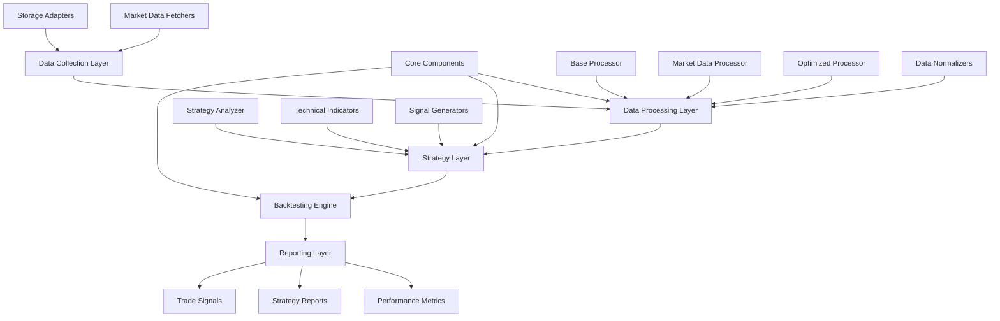

## System Architecture

### Overview

The market system is designed with a layered architecture that provides clear separation of concerns and modularity. The refactored architecture is based on a common core foundation with specialized components extending this base.



## Core Architecture

The system is built on a set of core components that provide common functionality:

### Base Classes
- **BaseProcessor**: Common file handling and data validation
- **MarketDataError**: Custom exception for error handling
- **ProcessingStats**: Performance tracking

### Specialized Processors
- **MarketDataProcessor**: Standard processing with data integrity checks
- **OptimizedMarketProcessor**: High-performance, memory-efficient processing for large datasets
- **MarketDataNormalizer**: Data standardization and normalization

### Utilities
- Memory management utilities
- Data transformation helpers
- Testing utilities

## Directory Structure

```
src/
├── market_system/          # Core market system package
│   ├── __init__.py         # Public API
│   ├── core/               # Core components
│   │   ├── __init__.py
│   │   ├── base_processor.py
│   │   ├── normalizer.py
│   │   ├── test_utils.py
│   │   └── utils.py
│   ├── domain/             # Domain models
│   │   └── models.py
│   ├── strategy/           # Strategy components
│   ├── backtesting/        # Backtesting engine
│   ├── market_data_processor.py
│   ├── optimized_market_processor.py
│   ├── strategy_analyzer.py
│   └── [other modules]
├── tools/                  # Utility scripts
│   ├── batch_processor.py
│   ├── load_to_influxdb.py
│   └── [other utility scripts]
```

## Implementation Details

### 1. Data Collection Layer
- **Market Data Fetchers**
  - API integrations for multiple data sources
  - Support for multiple exchanges (NYSE/NASDAQ/HKEX/ASX)
  - Rate-limiting and retry mechanisms
- **Storage Adapters**
  - Standardized JSON file format
  - Directory structure by market/symbol
  - Efficient data retrieval system

### 2. Data Processing Layer
- **Base Processing**
  - Common file handling and validation
  - JSON schema validation
  - Error handling and logging
- **Data Normalization**
  - Price and volume standardization
  - Date formatting
  - Market metadata enrichment
- **Optimized Processing**
  - Memory-efficient handling of large datasets
  - Chunked data processing
  - Parallel execution for performance

### 3. Strategy Layer
- **Strategy Analyzer**
  - Technical indicator calculation
  - Strategy evaluation
  - Performance metrics
- **Technical Indicators**
  - Moving Averages (SMA, EMA)
  - Relative Strength Index (RSI)
  - MACD, Bollinger Bands
- **Signal Generation**
  - Buy/Sell signal creation
  - Strategy-specific signals
  - Signal filtering and validation

### 4. Backtesting Engine
- **Performance Testing**
  - Strategy backtesting
  - Performance metrics
  - Portfolio simulation
- **Risk Management**
  - Position sizing
  - Stop-loss mechanisms
  - Drawdown analysis

### 5. Reporting Layer
- **Performance Metrics**
  - Sharpe ratio, maximum drawdown, win rate
  - Comparative strategy performance
  - Risk-adjusted returns
- **Strategy Reports**
  - Markdown-based reports
  - Performance visualizations
  - Trade analysis

## Data Flow

1. **Data Collection**: Market data is fetched and stored in standardized JSON format
2. **Normalization**: Raw data is normalized to ensure consistency
3. **Processing**: Data is efficiently processed and transformed for analysis
4. **Strategy Application**: Trading strategies are applied to processed data
5. **Backtesting**: Strategies are backtested against historical data
6. **Analysis**: Performance is analyzed and reported

## API Design

The system provides a clean, factory-based API:

```python
# Create optimized processor
processor = create_processor('/path/to/data', optimized=True)

# Process market data
market_data = processor.process_market_data('nyse')

# Create analyzer
analyzer = create_analyzer('/path/to/data')

# Analyze strategy performance
performance = analyzer.analyze_strategy(market_data, strategy_config)
```

## Performance Considerations

- **Memory Management**: Chunked processing to manage memory usage
- **Parallel Processing**: Distributes work across available CPU cores
- **I/O Optimization**: Efficient file reading and writing
- **Resource Monitoring**: Tracks system resource usage during processing

## Implementation Plan

### 1. Data Collection Module
- **API Integration**
  - yfinance API implementation
  - Support for multiple exchanges (NYSE/NASDAQ/HKEX/ASX)
  - Extensible design for adding new data sources
- **Data Storage**
  - JSON-based storage structure
  - Efficient data retrieval system
  - Data update and synchronization mechanism

### 2. Data Processing Module
- **Data Cleaning**
  - Handle missing data
  - Adjust for stock splits and dividends
  - Data validation and quality checks
- **Technical Indicators**
  - Moving Averages (SMA, EMA)
  - Relative Strength Index (RSI)
  - Moving Average Convergence Divergence (MACD)
  - Bollinger Bands
  - Volume indicators

### 3. Strategy Module
- **Base Strategy Framework**
  - Abstract strategy class
  - Signal generation interface
  - Risk management rules
- **Technical Indicator Strategies**
  - Moving Average crossover strategy
  - RSI overbought/oversold signals
  - MACD signal line crossovers
  - Bollinger Bands mean reversion
- **Composite Strategy**
  - Multiple indicator combination
  - Weighted signal generation
  - Strategy optimization capabilities

### 4. Backtesting Engine
- **Core Features**
  - Historical data simulation
  - Position sizing rules
  - Transaction cost consideration
  - Risk management implementation
- **Performance Metrics**
  - Total returns calculation
  - Sharpe ratio
  - Maximum drawdown
  - Win/loss ratio
  - Risk-adjusted returns

### 5. Reporting Module
- **Report Generation**
  - Markdown format reports
  - Performance metrics summary
  - Trade signals log
  - Position history
- **Visualizations**
  - Price charts with indicators
  - Performance charts
  - Drawdown analysis
  - Risk metrics visualization

## Project Structure
```
stock_trading_system/
├── data/
│   ├── fetchers/           # Data collection implementations
│   ├── processors/         # Data processing and cleaning
│   └── storage/           # Data storage management
├── strategies/
│   ├── indicators/        # Technical indicators
│   ├── base.py           # Base strategy class
│   └── composite.py      # Composite strategy implementation
├── backtesting/
│   ├── engine.py         # Backtesting core
│   └── performance.py    # Performance calculations
├── reporting/
│   ├── generator.py      # Report generation
│   └── templates/        # Report templates
└── config/               # Configuration files
```

## Implementation Steps

1. Set up project structure and dependencies
2. Implement data collection module
3. Develop technical indicators and data processing
4. Create strategy framework and implementations
5. Build backtesting engine
6. Develop reporting system
7. Testing and optimization
8. Documentation and deployment

## Technologies to Use
- Python 3.8+
- pandas for data manipulation
- numpy for numerical computations
- yfinance for data collection
- matplotlib/plotly for visualizations
- markdown for report generation

## Future Enhancements
- Real-time data streaming
- Machine learning integration
- Portfolio optimization
- Risk management improvements
- Additional technical indicators
- Web interface for visualization