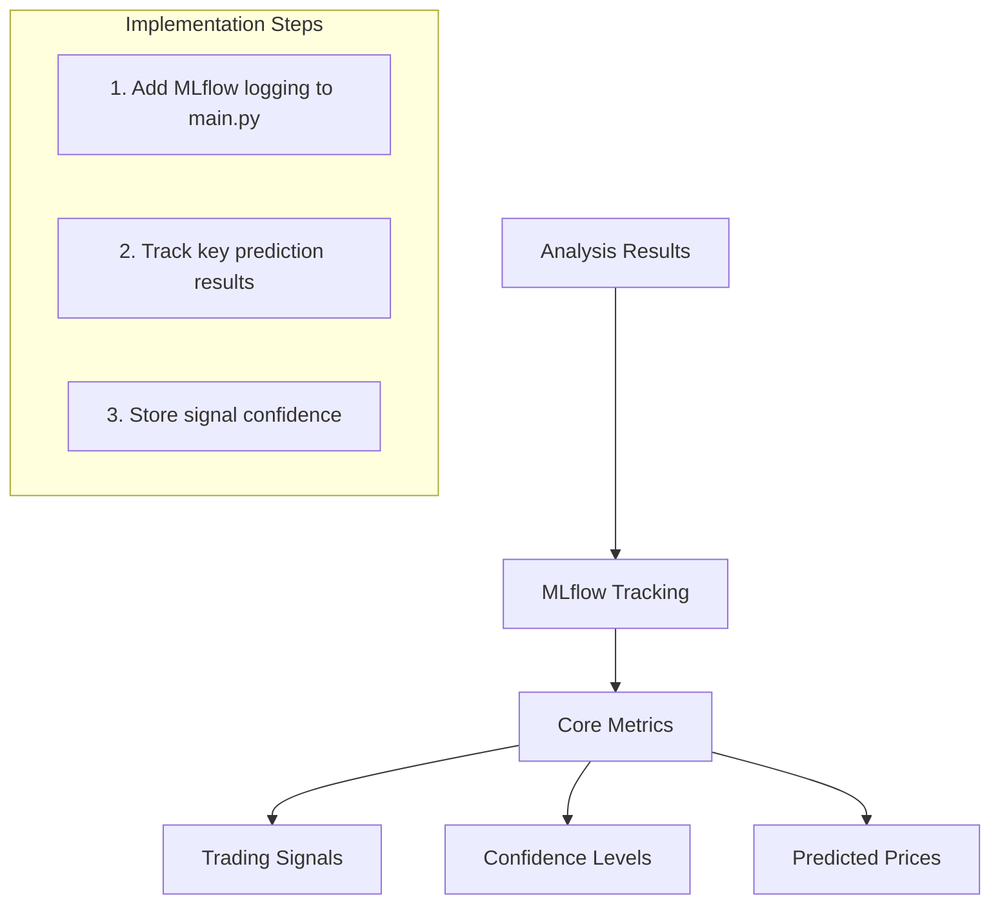
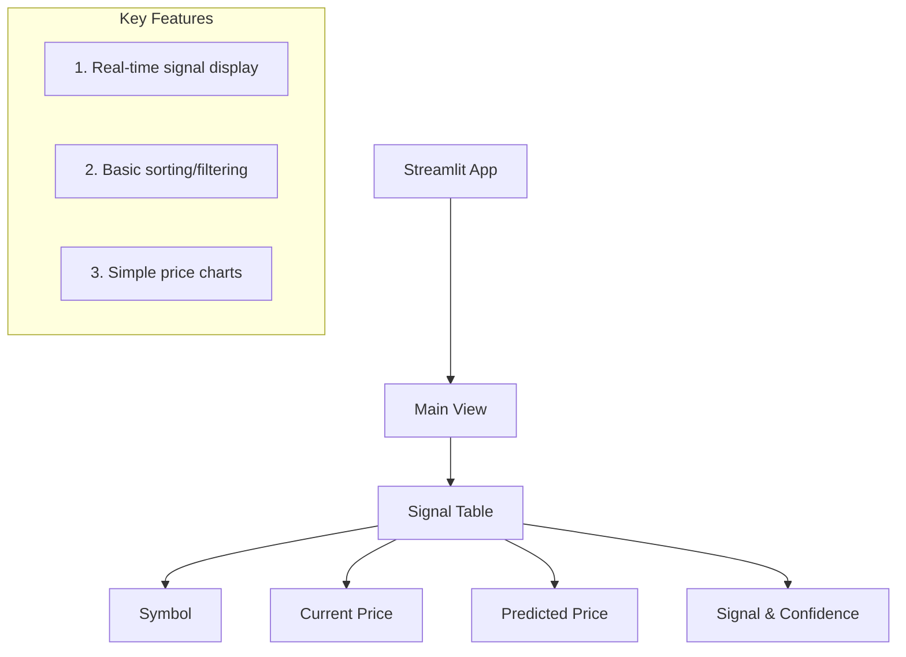

# Visualization Implementation Plan

## Overview
This document outlines the implementation plan for adding visualization capabilities to the stock analysis system using MLflow for tracking and Streamlit for interactive visualization. The plan focuses on core functionality first with room for incremental improvements.

## Implementation Phases

### Phase 1: Basic MLflow Integration

#### Key Components:
1. Add MLflow logging to main.py
   - Track experiment runs
   - Log prediction results
   - Store confidence metrics

2. Track key prediction results
   - Trading signals (Buy/Sell/Hold)
   - Predicted price movements
   - Confidence levels

3. Store signal confidence
   - Signal strength indicators
   - Prediction accuracy metrics
   - Risk assessment values

### Phase 2: Simple Streamlit Dashboard

#### Key Components:
1. Real-time signal display
   - Current trading signals
   - Latest price data
   - Prediction confidence

2. Basic sorting/filtering
   - Sort by confidence level
   - Filter by signal type
   - Search by symbol

3. Simple price charts
   - Historical price trends
   - Prediction visualization
   - Basic technical indicators

## Implementation Order:
1. MLflow integration for basic metrics
2. Simple Streamlit dashboard with current signals
3. Basic visualization of predictions
4. Essential interactivity features

## Future Enhancements
- Advanced technical analysis charts
- Historical performance tracking
- Portfolio analysis tools
- Custom alerts and notifications
- Advanced filtering and comparison tools